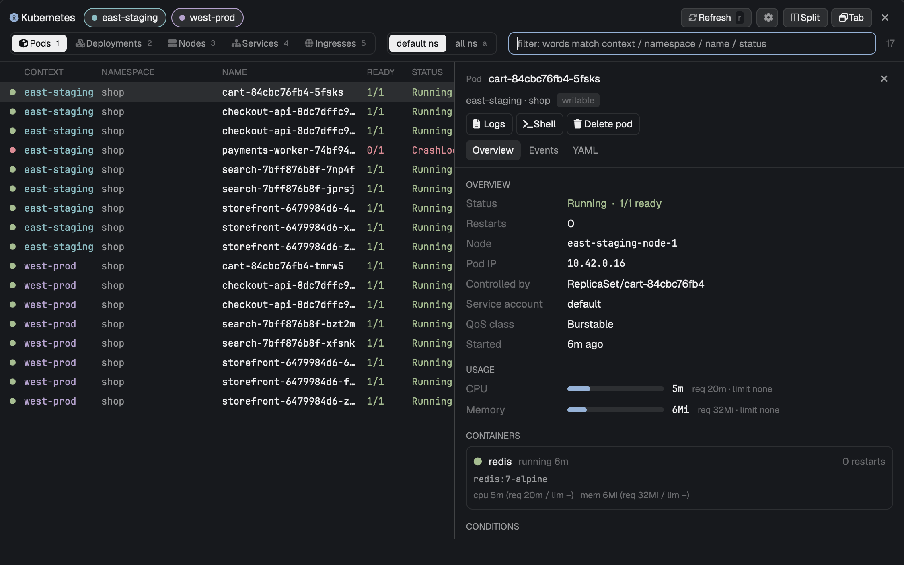
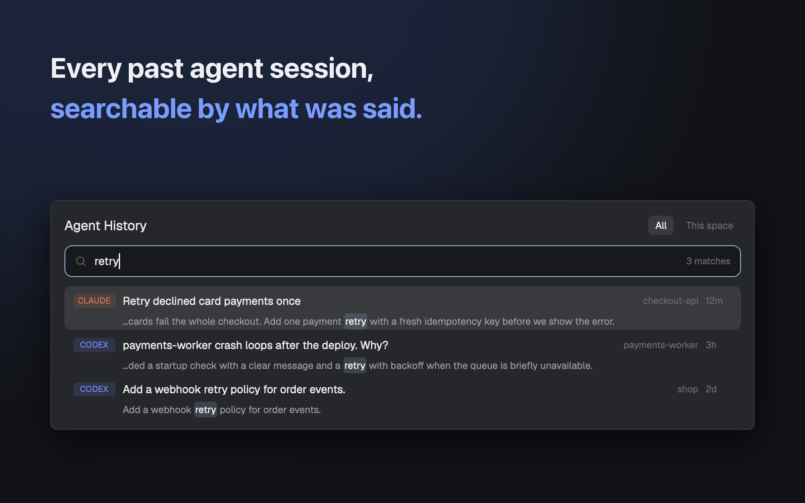
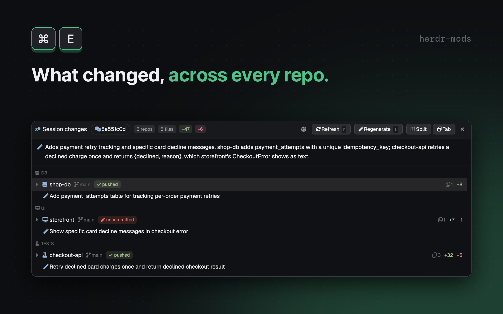
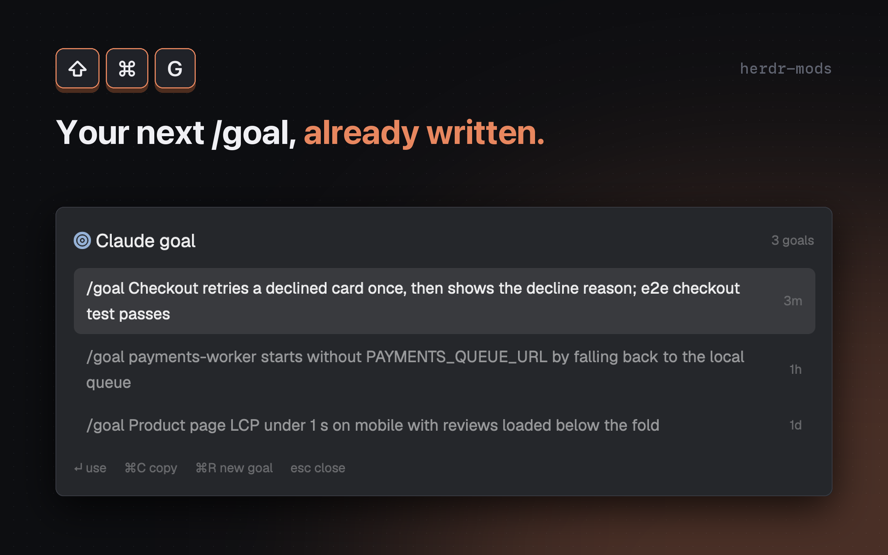
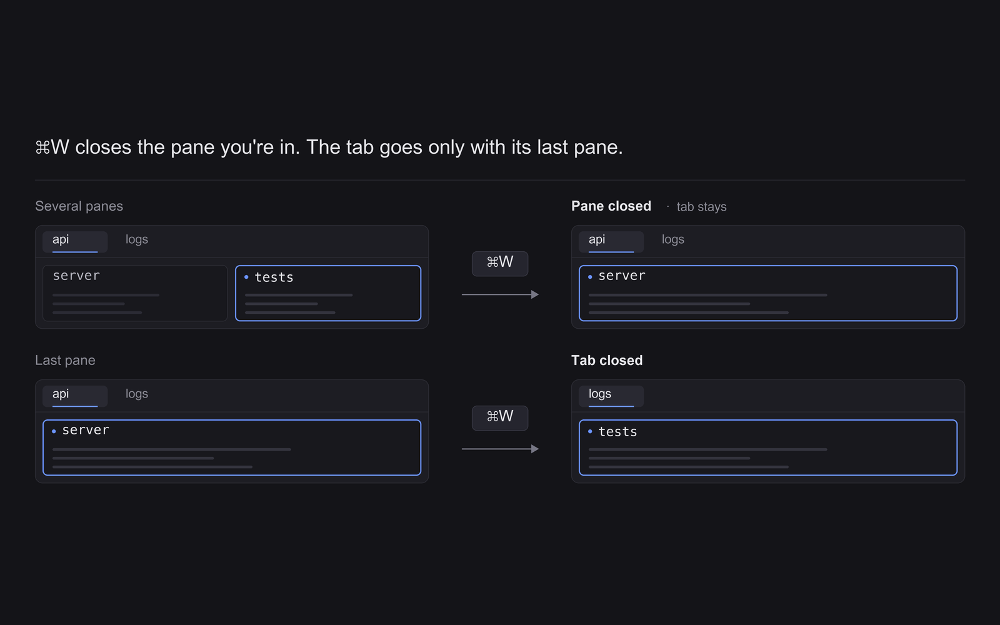

# herdr-mods

Add-ons for the [Herdr](https://herdr.dev) desktop app.

<table>
<tr>
<td width="50%"> <b><a href="kubernetes/">Kubernetes</a></b> <code>cmd-k</code> Browse pods, deployments and logs across clusters.</td>
<td width="50%"> <b><a href="agent-history/">Agent History</a></b> <code>cmd-y</code> Search every past Claude Code / Codex session by what was said, and resume it.</td>
</tr>
<tr>
<td> <b><a href="session-changes/">Session changes</a></b> <code>cmd-e</code> What a Claude Code session changed across every repo it touched, from an AI overview down to the diff.</td>
<td> <b><a href="claude-goal/">Claude goal</a></b> <code>cmd-shift-g</code> Write the next <code>/goal</code> for the Claude Code session in front of you.</td>
</tr>
<tr>
<td> <b><a href="smart-close/">Smart close</a></b> <code>cmd-w</code> Closes the pane you're in; the tab goes only with its last pane.</td>
<td> <b><a href="https://github.com/iml885203/orbit/tree/main/integrations/herdr-app">Orbit</a></b> <code>cmd-o</code> Your local Orbit environments: services, logs, traces. Lives in the Orbit repo.</td>
</tr>
</table>

## Install

Ask the agent in your Herdr app:

> Add herdr.dev/mods/iml885203/herdr-mods--kubernetes

That's it. To install by hand, see the mod's own README.

## Contributing a mod

Each folder with a `RECIPE.md` and a `preview.png` is one gallery item. Make the preview with `scripts/preview-card.py` so every card looks the same, and run `scripts/check.sh` before pushing.

## License

MIT
