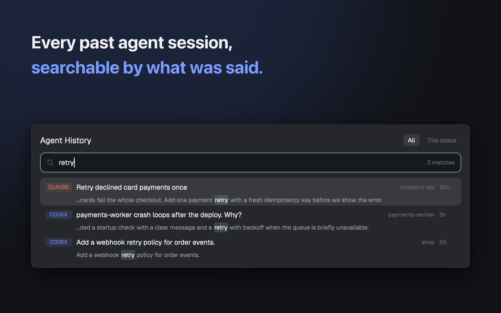

# Agent History

Search every past Claude Code and Codex session by what was said, then resume it. Press `cmd-y`. Based on [itisvincent/herdr-session-history](https://github.com/itisvincent/herdr-session-history) (MIT).



## Features

- Searches titles, your prompts, the agent's replies and tool input/output, including CJK text.
- With several words, all of them must appear in the same message, or in the session's title/folder.
- Shows the name you gave a Claude Code session with `/rename`, as `claude --resume` does; otherwise its generated title.
- Results are newest first, each with the folder, age and a snippet with the match highlighted.
- Resume opens a tab in the space whose folder matches the session (the current space when several match), or a new space if there is none.
- `All` or `This space` scope; copy the resume command; reveal the transcript file; delete it (two steps).
- The index updates itself while the popup is open.

## Requirements

- Herdr desktop app on macOS or Linux
- `python3` whose `sqlite3` has FTS5 with the trigram tokenizer (SQLite 3.34 or newer)
- Optional: `claude`, `codex` or `pi` on your `PATH` to resume those sessions

## Install

Copy `mods/agent-history` into `~/.config/herdr-app/mods/` (keep the folder name `agent-history`: the mod finds `index.py` by that path) and merge `keys.json` into your own:

```json
{ "global": { "cmd-y": "mod.open:agent-history" } }
```

Then run `herdr-app check mods/agent-history`. Or tell your Herdr agent to add `herdr.dev/mods/iml885203/herdr-mods--agent-history`.

## Keys

| Key | Action |
| --- | --- |
| `cmd-y` | Open the popup |
| Typing | Search (queries of 1-2 characters use a slower substring match) |
| `Up` / `Down` | Move; `PageUp` / `PageDown` move 8 |
| `Enter` | Resume the selected session |
| `Esc` | Close |

Clicking a row selects it; clicking the selected row resumes it. The buttons are `Resume`, `Copy cmd`, `Finder` (`Folder` on Linux) and `Delete`.

## What it runs / Safety

- It reads transcripts from `~/.claude/projects` (subagent folders skipped), `~/.codex/sessions` and `~/.pi/agent/sessions`, and copies their text (tool input/output cut to 800 characters per message) into a SQLite index at `~/Library/Caches/herdr-agent-history/index.db` on macOS, or under `$XDG_CACHE_HOME` (else `~/.cache`) as `herdr-agent-history/index.db` elsewhere. Anything sensitive in a transcript is also in that index; delete the folder to remove it.
- `Delete` removes the transcript file with `rm -f` and drops it from the index. It asks twice (`Delete`, then `Delete?`); it cannot be undone.
- Resume runs `claude --resume <id>`, `codex resume <id>` or `pi --session <file>` in the session's folder.
- Other programs it runs: `python3 -I index.py`, `rm`, `open -R` or `xdg-open`, `pbcopy` or `wl-copy`/`xclip`.

## Credit

Based on [herdr-session-history](https://github.com/itisvincent/herdr-session-history) by itisvincent (MIT).

## License

MIT
