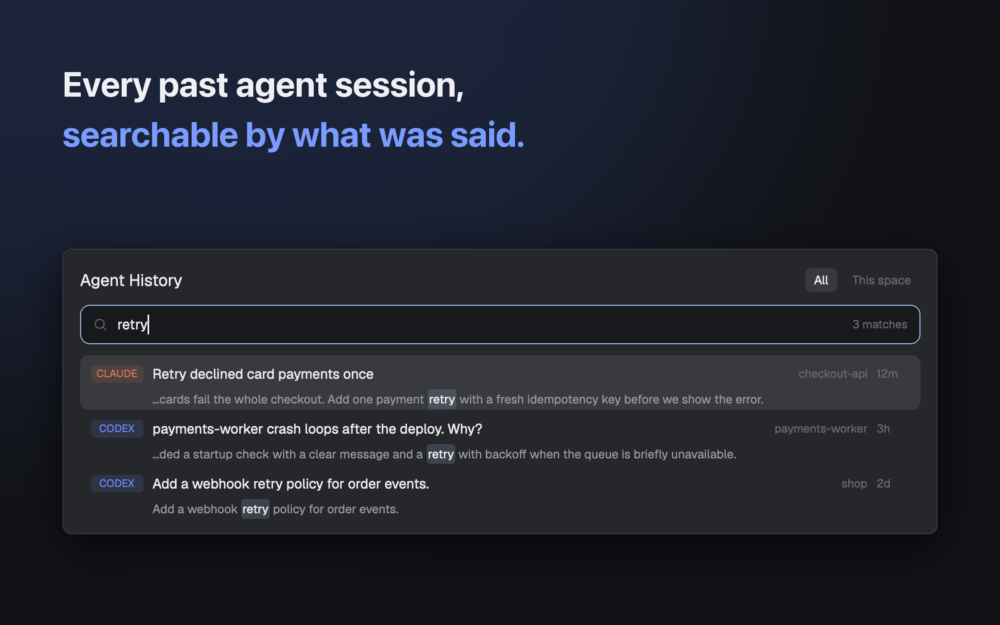

# Agent History

Search every past Claude Code and Codex session by what was said, then resume it.

## What you see

A popup (`mod.json`: `place: "none"`, title `Agent History`, overlay kind `popup`, `at: "top"`, offset 40, 800px wide, 0.8 of the window high). Background is the theme `popover` color, padding 16px, gap 10px, base text 13px. Top to bottom:

1. **Header row.** `Agent History` (15px, semibold) and, on the right, two scope tabs `All` and `This space` (22px high, 6px radius, 11px text; the active one has the `selected` background and `foreground` text, the other is dim with a `hover` background).
2. **Search box.** 36px high, 9px radius, 1px `accent` border, `background` fill, a search icon (15px, dim), the input (12.8px, placeholder `Search sessions: titles, prompts, replies, tool output…`, focused on open and again after 600 ms), and a status text on the right (10.5px, dim): `N sessions` with no query, `N matches` with one, `Searching…`, `Indexing… N left`, or an error in the `blocked` color.
3. **List**, a virtual list 550px high (11 rows of 50px) with a vertical scrollbar. Each row is 50px, 10px by 7px padding, 8px radius, `selected` background when selected or `hover` on hover:
   - First line: an agent badge (48px by 16px, 4px radius, 9.5px bold, the agent name in capitals on a 13% tint of its color: Claude `#D97757`, Codex `#6E8BFF`, any other agent such as Pi the theme `working` color), the title (12.5px, truncated; falls back to the first prompt, then the session id), the folder name (10.5px, dim), and the age (30px wide, dim: `now`, `Nm`, `Nh`, `Nd`, `Nmo`).
   - Second line, indented 56px, 11px muted: with a query, the snippet; with no query, the first prompt when the session has a title. The matched text is drawn on an accent tint (`accent` + `33`), in `foreground`, semibold. A snippet keeps at most 48 characters before the match, with a leading `…`.
   - Empty states: `No session mentions that.`, `No sessions in this space's folders.`, `No sessions yet.`
4. **Action row**, only when a row is selected: the session's folder (10.5px, dim, truncated; `(no folder recorded)` if none), then buttons 26px high, 11px text: `Resume ⏎` (accent fill), `Copy cmd`, `Finder` (macOS) or `Folder` (elsewhere), `Delete` (bordered). After the first press `Delete` is replaced by `Delete?` (filled `blocked`) and `Keep`.

## How it behaves

- **Open.** Loads the 300 newest sessions and runs `index.py update` at once; while `pending` is above zero it runs one 8 second slice per second tick (an error or an idle index falls back to one slice every 15 seconds), then every 15 seconds while the popup stays open. `update` sends the 300 newest sessions back in the same JSON only when something changed (a transcript indexed or removed); an unchanged run sends nothing and the list is left alone. New results refresh the list (and the current search).
- **No query.** Shows the newest sessions (those with a session id and a title or first prompt), newest first.
- **Search.** Typing waits 180 ms, then runs `index.py search <text> --limit 200`; stale answers are dropped, and an index update never runs the search while a typed one is still waiting out its 180 ms. When more than 200 sessions match, the status reads `200+ matches`. The query is split on spaces; every word must appear in the same message (user text, assistant text or tool text), or in the session's title/folder/session-id row; words spread over different messages do not match. Words of 3 or more characters go to FTS5 `MATCH` as quoted phrases joined by `AND`, on a `trigram` tokenizer (so CJK works); words under 3 characters fall back to `LIKE '%word%'` on the same columns. Case is ignored. A session's best row is picked by `bm25` with weights user 10, assistant 5, tool 1, title row 8 (0 when only short words), but the sessions are returned by file modification time, newest first. The snippet is 70 characters either side of the first hit found among that row's columns, whitespace collapsed.
- **Scope.** `All` shows everything. `This space` passes the active space's folders (its terminals' `cwd`s plus the space folder) to `index.py` as repeated `--cwd PATH`, which keeps sessions whose folder equals or lies under one of them (LIKE wildcards escaped) before the 300/200 cap, so the recent list, the search results and the `N+ matches` count are all per scope. Changing the scope, or the space's folders, reloads them; the selected row is tracked by transcript path across background re-sorts. With no active space the list is empty. The choice is kept with `setShared("agent-history.scope")`.
- **Keys.** `Esc` closes. `Up`/`Down` move one, `PageUp`/`PageDown` eight (clamped, scrolls into view, and cancels a pending delete). `Enter` in the box resumes. Clicking a row selects it; clicking the selected row resumes it. Changing the query cancels a pending delete.
- **Resume.** The command is `claude --resume <id>`, `codex resume <id>` or `pi --session <file>`; the folder is the session's recorded `cwd`, or the home folder. If a space on this computer (`machine` empty) has a folder (its own or a live terminal's) that the session's folder equals or lies under (the active one first when several do), runs `tab.new { name, space, folder, argv }` in it and runs `space.select` when it is not active; otherwise `space.new { name, folder, argv }`. The tab or space is named after the title, else the folder name, else the agent. Then the popup closes.
- **Copy cmd.** Copies `cd '<folder>' && '<arg>' …` (single-quoted) with `pbcopy` on macOS, or `wl-copy` (else `xclip -selection clipboard`) elsewhere. No feedback is shown.
- **Reveal.** `open -R <file>` on macOS; `xdg-open <folder of file>` elsewhere.
- **Delete.** First press arms it, second press runs `rm -f -- <transcript>` then `index.py forget <path>` and removes the row. Only that one transcript file goes.
- **Index (`index.py`).** Sources: `~/.claude/projects` (directories named `subagents` skipped), `~/.codex/sessions`, `~/.pi/agent/sessions`, files ending `.jsonl`. One FTS5 row per message with columns `user_text`, `assistant_text`, `tool_text`, `meta`, tokenizer `trigram`, plus one `meta` row per session holding title, folder and session id. Text is cut to 20000 characters per message and tool input/output to 800. Claude: `ai-title` becomes the title and `custom-title` (/rename) wins over it; `<system-reminder>` blocks and meta entries are dropped; user text starting with `<`, `# AGENTS.md` or `Caveat:` is treated as injected and not indexed. Codex: `session_meta`, messages and tool calls/outputs; the same injected-text rule. Pi: `session` and `message` entries. Files are read incrementally from the last offset (append-only), keyed by modification time and size; a file that shrank is re-read, a file that disappeared is dropped. Newest files are indexed first. The session's title/folder row is rewritten only when its text changed (its id and text are stored on the `files` row); after a catch-up run an FTS5 `merge` of bounded size keeps the index from bloating. Columns added to an existing database are migrated in place; only a database from before `custom_title` is rebuilt, once. A lock file (`update.lock`) makes a second concurrent `update` return `busy`. Commands: `update [--budget SECONDS] [--limit N]` (budget default 20; N newest sessions returned when something changed, default 300), `search QUERY [--limit N]` (default 60; also returns `capped`); `update` and `search` also take repeated `--cwd PATH`. A partial run keeps the real mtime and stores size = offset reached, `forget PATH`; each prints one JSON object.
- **Cache location.** `~/Library/Caches/herdr-agent-history/index.db` on macOS; otherwise `$XDG_CACHE_HOME/herdr-agent-history/` or `~/.cache/herdr-agent-history/`. The database uses WAL.

## Built from

- Files: `mods/agent-history/main.js`, `index.py`, `mod.json`, and `keys.json` (`{ "global": { "cmd-y": "mod.open:agent-history" } }`). `jsconfig.json` and `gpui-kit.d.ts` are generated by Herdr. Tests live outside the mod folder (`test/test_index.py`, run `python3 -I -m unittest discover -s test` from this folder).
- `main.js`: `class SessionHistory extends View` using `View`, `div`, `svg` from `gpui-kit` and `v_flex`, `h_flex`, `InputState`, `Input`, `Scrollbar`, `VirtualListScrollHandle`, `v_virtual_list` from `gpui-base`. No `props` roles beyond `props().overlay`. Row height 50. Snippets: `index.py` returns `snippet` as `{pre, hit, post}` and `main.js` draws the three parts directly. Results carry `agent`, `id`, `path`, `cwd`, `title`, `preview`, `mtime`, `snippet`; `main.js` builds the resume command from `agent`/`id`/`path`.
- `herdr` functions: `spaces`, `panes`, `run`, `theme`, `shared`, `setShared`, `exec`, `home`, `appHome`, `props`, `closeOverlay`, `window` (`window()?.platform === "macos"` picks the macOS helpers).
- Commands: `tab.new`, `space.new`, `space.select`. Programs: `python3 -I <app home>/mods/agent-history/index.py`, `rm`, `open`, `xdg-open`, `pbcopy`, `wl-copy`, `xclip`, `sh`.
- Art: the shipped `mods/workspace-chrome/search.svg` for the search icon.
- Timers: `cx.timer.after(600)` (refocus), `cx.timer.every(1000)` (index tick: starts a slice when 15 s passed since the last one, or at once while `pending` is above zero), `cx.timer.after(180)` (debounce), all cancelled in `close()`.
- `index.py`: Python 3 standard library only (`fcntl`, `sqlite3`, `json`, `re`, `os`).

## Watch out

- **Folder name.** The path to `index.py` is `<app home>/mods/agent-history/index.py`, so the folder must be `mods/agent-history/`. `cmd-y` is taken in `keys.json`; ask before replacing an existing `cmd-y`.
- **SQLite.** `python3` must have `sqlite3` with FTS5 and the `trigram` tokenizer (SQLite 3.34+). If not, the status line shows the error from `index.py`. `fcntl` means no Windows.
- **Plain-text copy of transcripts.** The index holds the text of your conversations (and 800 characters of each tool input/output) unencrypted in the cache folder.
- **First run.** The first index of a large history takes several 8 second slices (a slice stops inside a large transcript at its deadline and resumes from the byte offset it reached; transcripts are streamed, so memory stays around 100 MB); the list fills as it goes, and `Indexing… N left` shows progress. Searches work on what is indexed so far.
- **Limits.** 300 sessions with no query, 200 results with a query, 11 rows visible.
- **Result order.** Sessions are ordered by file modification time, not by relevance; `bm25` only picks which message to show as the snippet. Every matching session is considered (no row cap before grouping).
- **Pi.** Pi sessions are resumed by file path (`pi --session <file>`); the badge uses the theme `working` color.
- **Delete.** If `rm` fails the row still disappears from the list; the next `update` finds the file again and re-adds it.
- **Construction traps.** Timers and host objects are created in `init` and handlers, never in `render`. Calls to `index.py` always go through `python3 -I` so a stray `json.py` or `sqlite3.py` in the working folder cannot be imported.
- **Gaps.** No date filter, no agent filter, no preview of the full conversation, no Windows support.

## Done when

- `herdr-app check mods/agent-history` passes (run from the folder that holds `mods/` and `keys.json`).
- `cmd-y` opens an 800px popup with the search box focused, and `index.db` appears in the cache folder for your platform.
- With no query the list shows recent sessions, newest first, with `CLAUDE`, `CODEX` or `PI` badges.
- Typing a word that occurs in an older conversation shows that session with the word highlighted; a Chinese or Japanese word also matches; a one- or two-character query still returns results.
- `This space` hides sessions from folders outside the active space.
- `Enter` on a session whose folder matches an open space adds a tab there (in the current space when several share that folder) running `claude --resume <id>` (or the Codex/Pi equivalent); with no matching space it creates one.
- `Copy cmd` puts `cd '<folder>' && 'claude' '--resume' '<id>'` on the clipboard.
- `Delete` once changes the button to `Delete?` and `Keep`; `Keep` or moving the selection cancels; `Delete?` removes the transcript file and the row.
