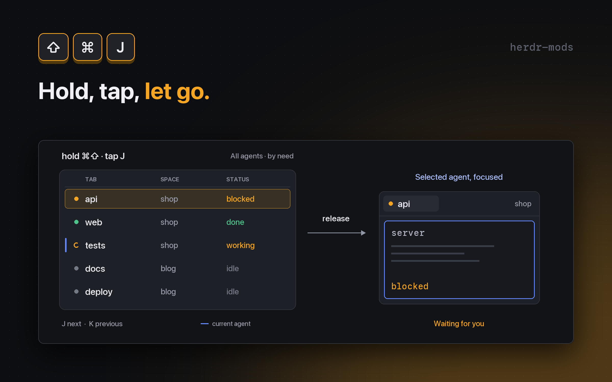

# Attn next

Hold `cmd-shift`, tap `J`: every agent, the ones that need you first. Let go to jump.



## Features

- `cmd-shift-j` opens a popup listing all agents with their space and status.
- Order: Herdr's own agent order when nothing is blocked or done; otherwise blocked, done, working, idle.
- The selection starts on the first agent that is not you, or, when nothing needs you, on the agent after yours (like `cmd-]`).
- Keep holding `cmd-shift` and tap `J` (down) or `K` (up) to move; release cmd to jump.
- A quick tap still works: the mod checks whether cmd is already up.
- `Esc` closes, `Enter` or a click jumps. An accent bar marks the agent you are on.

## Requirements

- Herdr desktop app on macOS (the quick-tap check uses `osascript`)

## Install

Copy `mods/attn-next` into `~/.config/herdr-app/mods/` and merge `keys.json` into your own. Both sections are needed:

```json
{
  "global": { "cmd-shift-j": "mod.open:attn-next" },
  "mod:attn-next": {
    "cmd-shift-j": "attn-next.next",
    "cmd-shift-k": "attn-next.prev"
  }
}
```

Then run `herdr-app check mods/attn-next`. Or tell your Herdr agent to add `herdr.dev/mods/iml885203/herdr-mods--attn-next`.

## Keys

| Key | Action |
| --- | --- |
| `cmd-shift-j` | Open the switcher; while open, move down |
| `cmd-shift-k` | Move up (while open) |
| release `cmd` | Jump to the selected agent |
| `Enter` / click | Jump to the selected agent |
| `Esc` | Close without jumping |

## What it runs / Safety

- It calls the Herdr command `agent.focus`, and runs `osascript -l JavaScript` once or twice to read the current modifier flags (read-only). It reads and writes no files.
- It only moves focus; it never answers, closes or changes an agent.
- It takes over `cmd-shift-j`; remove the keys from `keys.json` to get the old behavior back.

## License

MIT
