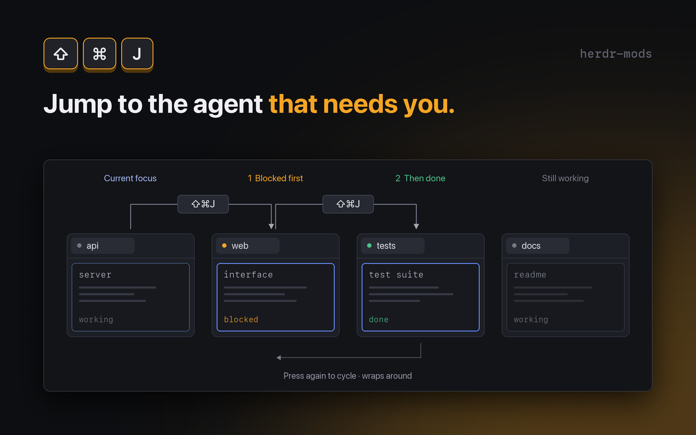

# Attn next

`cmd-shift-j` jumps to the next agent that needs you: waiting for input first, then finished.

## What you see

Almost nothing. The mod is declared as a popup (`mod.json`: `place: "none"`, title `Next agent needing me`, overlay kind `popup`, width `1`, height `1`), and `render()` returns an empty `div()`. The popup is closed inside `init()`, so what you see is the result: focus moving to another agent, or a short toast when no agent needs you.

## How it behaves

- `cmd-shift-j` (bound under `global` in `keys.json` to `mod.open:attn-next`) opens the mod. `init()` runs once per key press and does everything:
  1. If the mod was opened as an overlay (`props().overlay` is set), closes that overlay with `closeOverlay`.
  2. Reads every agent with `agents()` and builds the queue (`queue()` in `pick.js`): agents whose `status` is `blocked` first, then agents whose `status` is `done`, each group sorted by `seq`. Sub-agents are rows of `agents()` too, so they are queued like any other.
  3. Picks the next one (`pickNext()`): the entry after the agent with `focused` set, wrapping around to the start of the queue. If the focused agent is not in the queue, it picks the first entry.
  4. If there is one, runs `agent.focus` with `{ terminal: next.address }`.
  5. If the queue is empty, shows a toast with `notify`: title `No agent needs you`, timeout 2000 ms.
- Pressing the key again moves on to the following agent in the queue, so repeated presses walk through everything that needs you.
- No confirmation, no animation, and no state kept between presses.

## Built from

- Files: `mods/attn-next/main.js`, `mods/attn-next/pick.js`, `mods/attn-next/mod.json`, and `keys.json`. `jsconfig.json` and `gpui-kit.d.ts` in the folder are generated by Herdr and are not needed in a fresh build.
- `main.js`: one class `AttnNext extends View` (from `gpui-kit`, with `div`), with `init()` and `render()`.
- `pick.js`: two pure functions, `queue(agents)` and `pickNext(agents)`, with no `herdr` imports so they can be tested under Node.
- `herdr` functions used: `agents()`, `props()`, `closeOverlay()`, `run()`, `notify()`.
- Command called: `agent.focus` with `{ terminal }`.
- `keys.json`: `{ "global": { "cmd-shift-j": "mod.open:attn-next" } }`.
- No external programs, no files, no art.

## Watch out

- **Folder name.** The key is `mod.open:attn-next`, so the folder must be `mods/attn-next/`.
- **It takes `cmd-shift-j`.** If that key is already bound in `keys.json`, ask before replacing it.
- **Focus without selecting first.** `agent.focus` is called with the terminal address only; the mod does not select the space or tab beforehand. Other mods do the same. Behaviour when the target agent is in another space has not been verified.
- **Order is by `seq`, not by how long an agent has waited.** `blocked` always comes before `done`, whatever the `seq` values.
- **Gaps.** No configuration, no way to dismiss a `done` agent from the queue other than the agent's own status changing.

## Done when

- `herdr-app check mods/attn-next` passes (run from the folder that holds `mods/` and `keys.json`).
- With one blocked agent and one done agent, `cmd-shift-j` focuses the blocked one; pressing it again focuses the done one; pressing it a third time wraps to the blocked one.
- When the focused agent is not blocked or done, `cmd-shift-j` focuses the first agent in the queue.
- With no blocked or done agent, `cmd-shift-j` shows the toast and focus does not change.
- No popup stays on screen after the key press.
- The pure logic in `pick.js` can be checked under Node: queue order (blocked, then done, each by `seq`), next after the focused agent, wrap-around, focused-not-queued gives the first, and an empty list gives `null`. The source mod keeps this as `check-pick.mjs` outside the published folder.
