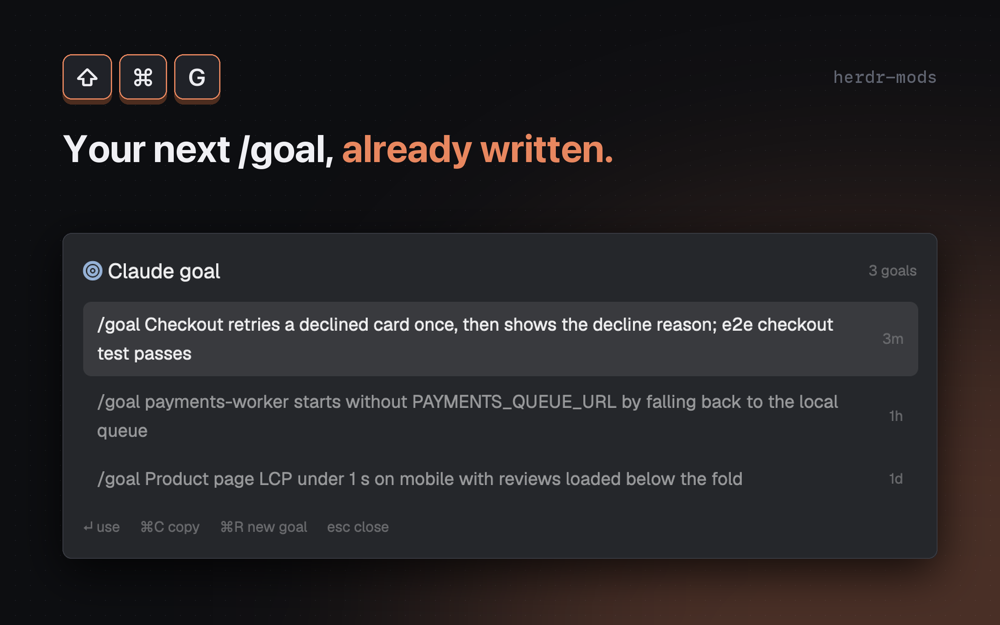

# Claude goal

Writes a `/goal` line for the Claude Code session in your focused terminal, in the [Herdr](https://herdr.dev) desktop app. Press `cmd-shift-g`, pick a goal, and it is pasted into the Claude Code prompt for you to review and send.



## Features

- Reads the focused terminal's Claude Code session and its recent conversation, and asks Claude to write one short goal for what to do next.
- Keeps up to 20 goals per session, newest first, so reopening shows the earlier ones instead of calling the model again.
- `Enter` pastes `/goal <text>` into the terminal without pressing Enter; `cmd-c` copies it; `cmd-r` writes a new one.
- Writes in the language set in Claude Code's `language` setting (`~/.claude/settings.json`), or, without one, in the language you use in the conversation.

## Requirements

- Herdr desktop app on macOS or Linux
- Claude Code (`claude` on your `PATH`) with the `/goal` command, running in the focused terminal
- `jq`, `perl`, `find`, `mktemp` and the `hc` command that ships with Herdr
- Optional: `JetBrainsMono Nerd Font` for the icons; set `GOAL_MODEL` to change the model (default `sonnet`); set Claude Code's `language` setting to fix the goal's language (for example `"language": "繁體中文"`)

## Install

Copy `mods/claude-goal` into `~/.config/herdr-app/mods/` and merge `keys.json` into your own:

```json
{ "global": { "cmd-shift-g": "mod.open:claude-goal" } }
```

Then run `herdr-app check mods/claude-goal`. Or tell your Herdr agent to add `herdr.dev/mods/iml885203/herdr-mods--claude-goal`.

## Keys

| Key | Action |
| --- | --- |
| `cmd-shift-g` | Open the popup |
| `Up` / `Down` | Move through the goals |
| `Enter` | Paste the goal into the terminal (you press Enter yourself) |
| `cmd-c` | Copy the goal and close |
| `cmd-r` | Write a new goal |
| `Esc` | Close |

Clicking a goal selects it; clicking the selected goal pastes it.

## What it runs / Safety

- Each new goal is a paid model call: `goal.sh` runs `claude -p --model "${GOAL_MODEL:-sonnet}"`. It sends up to about 14 KB of the session's recent text (your messages and the assistant's replies, system reminders and command tags removed) to the model. Opening the popup on a session with no saved goal generates one right away; later opens reuse the saved list.
- It reads `~/.claude/sessions/<pid>.json` and `~/.claude/projects/*/<session>.jsonl`. These are Claude Code internals and may change between versions.
- Goals are saved in `~/.config/herdr-app/data/claude-goal/<session-id>.json` (20 per session).
- `Enter` puts the goal on the clipboard and pastes it with `terminal.paste`. Herdr has no command that types text without submitting it, so the clipboard still holds the goal afterwards.
- The call runs without tools, MCP servers or saved session, in a temporary folder that is deleted afterwards.
- Other programs it runs: `hc get`, `sh`, `mkdir`.

## License

MIT
