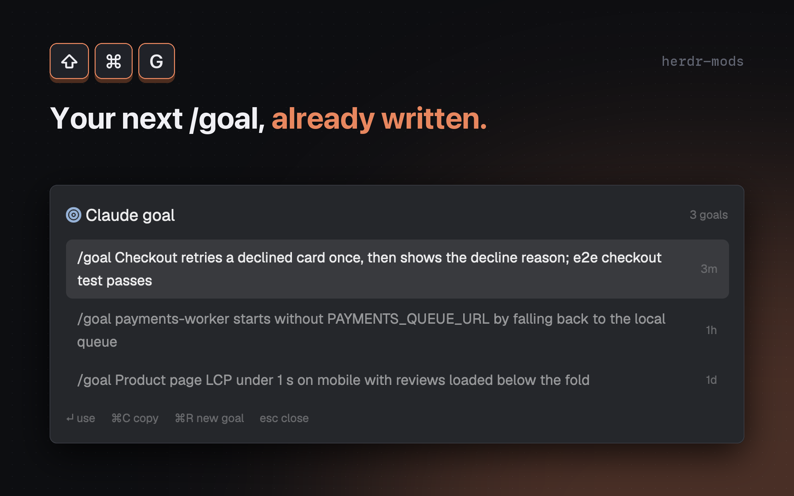

# Claude goal

A popup, opened with `cmd-shift-g`, that writes the next `/goal` for the Claude Code session in the focused terminal. It reads that session's recent conversation, has Claude summarize it into one short goal, keeps a per-session history, and on `Enter` pastes `/goal <text>` into the terminal prompt without submitting it.

## What you see

A popup (`mod.json`: `place: "none"`, title `Claude goal`, overlay kind `popup`, `at: "top"`, offset 40, 640px wide, 320px high). Background is the theme `popover` color, padding 16px, gap 10px, base text 13px. Top to bottom:

1. **Header row.** A Nerd Font circle glyph (`\u{f140}`, 15px, accent color), `Claude goal` (15px, semibold, `foreground`), a spacer, and when there are goals a dim 10.5px count `N goals`.
2. **Banner**, only when needed, with an 8px radius, 1px border and a tinted background (`tint(color, alpha)` takes the first 7 characters of the theme color and appends an alpha: border `66`, fill `14`).
   - Error: `blocked` color, an info glyph (`\u{f06a}`) and the message, wrapped.
   - Busy: `accent` color, a spinner glyph (15px) and `Loading…` or `Writing a goal…`; while generating, a dim 10.5px `about 3 s` on the right.
3. **Goal list**, flexible, scrolls vertically, 2px gap. Each row is 6px by 10px padding, 6px radius, a 10px gap; the goal text fills the row (`foreground` when selected, `muted` otherwise; wraps) and a dim 10.5px age on the right (`now`, `Nm`, `Nh`, `Nd`). The selected row has the `selected` background; others use `hover` on hover.
4. **Footer hints**, 10.5px dim, 14px apart: `↵ use`, `⌘C copy`, `⌘R new goal`, `esc close`.

Icons are drawn with `JetBrainsMono Nerd Font` when `fonts()` lists it, otherwise with `settings().font_family` (or `JetBrains Mono`), where they show as missing glyphs.

## How it behaves

- **Opening.** The popup remembers `focused()?.terminal`. With none, the banner says `No terminal focused`. Otherwise it runs `hc get <terminal> --json`, takes `foreground`, and requires `foreground.argv[0]` (basename) to start with `claude` and a `pid` to exist; then reads `~/.claude/sessions/<pid>.json` and its `sessionId`. If any step fails, the banner says `This terminal is not running Claude Code` (or the error text).
- **History.** Goals are loaded from `<app home>/data/claude-goal/<sessionId>.json`, a JSON array of `{ goal, at }`, newest first. If it is empty, a goal is generated at once. Otherwise nothing is generated until you press `cmd-r`.
- **Generating.** Runs `sh <app home>/mods/claude-goal/goal.sh <sessionId>`, takes the first non-empty stdout line, drops a leading `/goal `, and stores `/goal <line>`. A repeat of an existing goal moves to the top instead of duplicating; the list keeps 20. The new goal becomes the selected row. A failure shows the stderr text (or `exit <code>`) in the red banner.
- **Spinner.** Eight frames from `U+F0A9E` (one slice at a time), advanced every 110 ms only while loading or generating.
- **Keys.** `Esc` closes. `cmd-r` generates (ignored with no session or while generating). With a selection: `Enter` uses the goal, `cmd-c` copies it and closes, `Up`/`Down` move (clamped). Clicking an unselected row selects it; clicking the selected row uses it.
- **Use (`Enter`).** Writes the goal to the clipboard, closes the popup, runs `pane.focus` with `{ terminal }`, then `terminal.paste`. The text lands in the Claude Code prompt without Enter, so you read it and press Enter yourself. The clipboard keeps the goal afterwards, because no Herdr command types text without submitting it.
- **`goal.sh`.** Finds `$HOME/.claude/projects/*/<sid>.jsonl` (depth 2). Keeps the last 4000 lines, selects user and assistant entries that are not `isMeta` or `isSidechain`, keeps their text (a string, or text blocks joined by newlines), removes `<system-reminder>` blocks and `command-*` / `local-command-*` tag blocks with `perl`, and keeps the last 14000 bytes. It builds a prompt asking for one line of about 20 words, written in the language from `jq -r '.language // empty' ~/.claude/settings.json` (Claude Code's `language` setting) or, when that is empty or unreadable, in the language the user writes in, finished state plus the single most important done-condition, not starting with `report`, `reply`, `explain`, `ask` or `confirm whether`, no markdown, no final period, output only `<goal>…</goal>`. It runs, in a temporary folder, `claude -p --model "${GOAL_MODEL:-sonnet}" --system-prompt <fixed text> --tools "" --no-session-persistence --disable-slash-commands --strict-mcp-config --setting-sources ""` with the prompt on stdin, and prints the text inside `<goal>` on one line. Exit codes: 2 no transcript, 3 empty conversation, 4 no `<goal>` in the reply.

## Built from

- Files: `mods/claude-goal/main.js`, `goal.sh`, `mod.json`, and `keys.json` (`{ "global": { "cmd-shift-g": "mod.open:claude-goal" } }`). `jsconfig.json` and `gpui-kit.d.ts` are generated by Herdr.
- `main.js`: `class Goal extends View` using `View`, `div` from `gpui-kit` and `v_flex`, `h_flex` from `gpui-base`. No `props` roles beyond `props().overlay`. Constants: history folder `${appHome()}/data/claude-goal`, `KEEP = 20`.
- `herdr` functions: `appHome`, `closeOverlay`, `exec`, `focused`, `fonts`, `hc`, `home`, `props`, `readTextFile`, `run`, `settings`, `theme`, `writeTextFile` (called with the previous text so a concurrent change is detected).
- Commands: `pane.focus {terminal}`, `terminal.paste`. Clipboard through `cx.write_to_clipboard`. Timers: `cx.timer.after(50)` to focus the popup, `cx.timer.every(110)` for the spinner, both cancelled in `close()`.
- Programs: `hc get`, `sh`, `mkdir -p`; in `goal.sh`: `find`, `mktemp`, `tail`, `jq`, `perl`, `tr`, `grep`, `claude`.
- Environment: `GOAL_MODEL` (default `sonnet`).
- Claude Code setting: `language` in `~/.claude/settings.json`, read by `goal.sh` to pick the goal's language.
- No art; icons are font glyphs.

## Watch out

- **Folder name.** Install as `<config>/mods/claude-goal/` with `main.js`, `goal.sh`, `mod.json`; `main.js` runs `goal.sh` by that path.
- **Every generation is a paid model call**, and sends up to 14000 bytes of conversation text to the model. Opening the popup on a session with no saved goals generates one without asking.
- **Internals.** It depends on `~/.claude/sessions/<pid>.json` holding `sessionId`, on transcripts being at `~/.claude/projects/<dir>/<sessionId>.jsonl` with the entry shape the `jq` filter expects, and on `hc get` reporting `foreground.argv` and `foreground.pid`. A Claude Code update can change any of these. A session whose foreground process does not start with `claude` (for example one launched through `node`) is not recognized.
- **Needs** `claude` (with `/goal` support), `jq`, `perl`, `find`, `mktemp`, and `hc`, on the PATH seen by Herdr's `exec`. `GOAL_MODEL` is read from that same environment.
- **Paste, not type.** `terminal.paste` pastes the clipboard, so your previous clipboard content is replaced. The first `Enter` after pasting is yours; the mod never submits.
- **Run order.** Everything after the click or key (clipboard, close, focus, paste) happens in one handler, because the mod stops once its popup closes.
- **Limits.** 20 goals per session; 4000 transcript lines; 14000 bytes of conversation; goal asked to be about 20 words. `about 3 s` is a fixed label, not a measurement.
- **Gaps.** No delete for saved goals, no model picker in the UI, no support for other agents, no scrolling of the selection into view for long lists.

## Done when

- `herdr-app check mods/claude-goal` passes (run from the folder that holds `mods/` and `keys.json`).
- In a terminal not running Claude Code, `cmd-shift-g` shows a red banner `This terminal is not running Claude Code`.
- In a terminal running Claude Code with some conversation, the popup shows `Writing a goal…`, then one row starting with `/goal `, and `~/.config/herdr-app/data/claude-goal/<sessionId>.json` exists.
- Closing and reopening shows the saved goal without a spinner; `cmd-r` adds a new row on top and the count grows; after 21 generations the count stays 20.
- `Enter` closes the popup and the Claude Code prompt contains `/goal …` that has not been sent.
- `cmd-c` closes the popup and the clipboard holds the goal.
- `sh mods/claude-goal/goal.sh <sessionId>` run by hand prints one line, and `GOAL_MODEL` changes the model used.
- With `"language": "繁體中文"` in `~/.claude/settings.json`, a session dictated in Simplified Chinese or written in English still gets a Traditional Chinese goal; without the setting, the goal follows the conversation.
