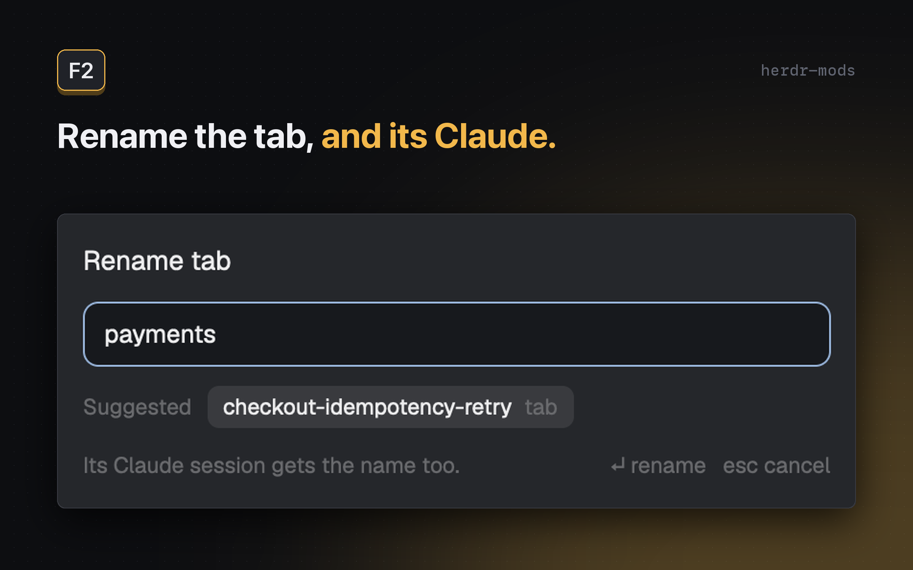

# Claude tab name

A tab and its Claude Code session keep the same name: `/rename` in Claude renames the tab, and `F2` renames both.



## Features

- `/rename <name>` in Claude Code: the tab takes the name within a second.
- `F2` in Herdr: rename the tab, and the Claude in it gets `/rename <name>` typed for it. Works while Claude is busy too.
- `F2` suggests a name for what that Claude is working on, like `checkout-idempotency-retry`: 2-3 lowercase words, 4 at most. `Tab` (or a click) puts it in the field; it never fills the field by itself. A suggestion is kept for 5 minutes per session.
- Only names you gave count. Claude's own automatic titles never rename a tab.
- An empty name puts the tab back to its number and leaves Claude's name alone (Claude has no "no name").

## Requirements

- Herdr desktop app on macOS or Linux
- Claude Code (it writes `~/.claude/sessions/<pid>.json`, which this reads)
- `jq` and `perl` for the name suggestion

## Install

1. Copy `mods/claude-tab-name` into `~/.config/herdr-app/mods/`.
2. Merge `keys.json` into your own: `{ "global": { "f2": "mod.open:claude-tab-name" } }`.
3. Add a 0 px block to your layout (a personal one: clone a shipped layout first), anywhere in its tree:

   ```json
   { "id": "claude-tab-name", "type": "block", "size": { "px": 0 }, "content": { "mod": "claude-tab-name" } }
   ```

   This copy does the `/rename` → tab part. Don't mark it `"hidden": true`: a hidden block never starts its mod.
4. Run `herdr-app check ~/.config/herdr-app/mods/claude-tab-name`.

Or tell your Herdr agent to add `herdr.dev/mods/iml885203/herdr-mods--claude-tab-name`.

## Double-click in your tab bar

A tab bar can send its rename through this popup too, so a double-clicked tab renames its Claude as well. Open it with the tab's id:

```js
import { openOverlay, keys, run, spaces } from "herdr";
const local = spaces().some((sp) => !sp.machine && sp.tabs.some((t) => t.id === tabId)); // this machine's tabs only
if (local && keys().some((k) => k.action === "mod.open:claude-tab-name"))
  openOverlay({ mod: "claude-tab-name", kind: "popup", width: 420, height: 164, props: { tab: tabId } });
else run("tab.rename", { id: tabId });
```

Herdr's own tab bar can't be edited (shipped mods are read-only): clone it with `mod.clone` first.

## Keys

| Key | Action |
| --- | --- |
| `F2` | Rename the focused tab, and its Claude session with it |

## What it runs / Safety

- Watches `~/.claude/sessions/` (small files Claude Code keeps per running session) and reads them when one changes, and every 15 seconds anyway, and runs `hc get <terminal>` to match a session to its terminal (when a Claude appears or restarts, and every 30 seconds).
- `F2` reads that Claude's screen (`hc read`) and types `/rename <name>` into it with `hc send` (run through `env` without Herdr's `HC_*` variables), as if you had typed it. The draft check uses `hc keys` and `sleep`. The name is one line of printable text (no control, zero-width or bidi characters), at most 100 characters.
- It never types over your work. It renames only the tab, and tells you to run `/rename` yourself, when Claude's prompt has unsent text, when Claude is asking you a question (a permission prompt), when a picker or dialog is open, when Claude's prompt is in vim mode, or when it can't read Claude's screen. To tell your draft from Claude's grey suggestion it may type one `x` and delete it again within half a second while Claude waits for you, so the prompt ends as it was.
- The tab follows Claude when Claude's name changes, and whenever the mod first sees a Claude (Herdr starting, a new Claude pane, a layout switch). A tab you renamed some other way (not `F2`) gets Claude's name back then.
- Each `F2` on a Claude tab runs `name.sh`: it reads the end of that session's conversation (about 6 KB of its text) and asks `claude -p --model haiku` for a name, with no tools, no MCP and no session saved. That is one small Haiku call on your Claude account per `F2`, at most every 5 minutes per session (every minute while it keeps failing), and none when you close the popup within 0.4 s.
- Only this machine's tabs; spaces on other machines are skipped.

## License

MIT
