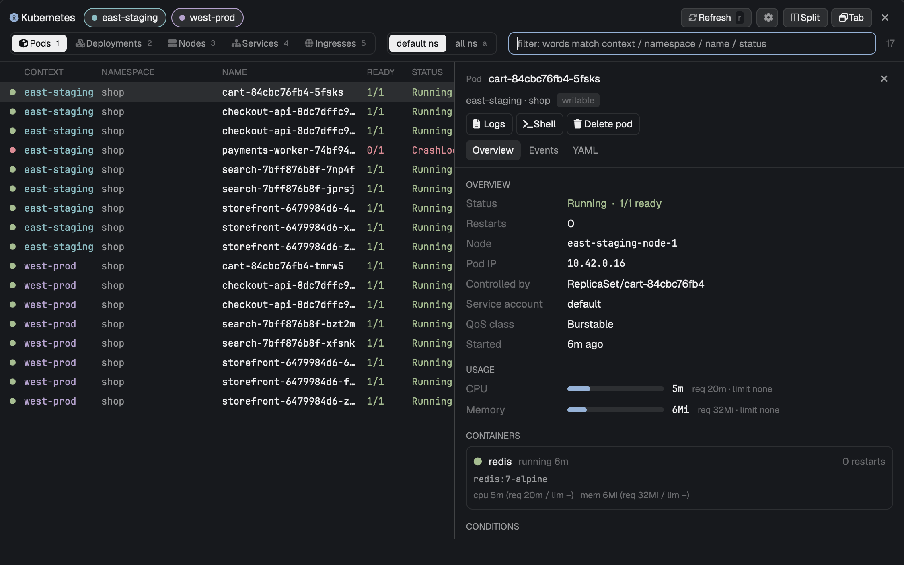

# Kubernetes

A k9s-style Kubernetes browser for the [Herdr](https://herdr.dev) desktop app. Press `cmd-k` for a floating window that lists pods, deployments, nodes, services and ingresses across several kubeconfig contexts at once, with a detail side panel and live logs.



## Features

- One pill per kubeconfig context; select several and see their rows together, colored per context.
- Pods, Deployments, Nodes, Services and Ingresses, each with its own columns and status colors; default namespace or all namespaces.
- Word filter with completions (context, namespace, name, status).
- Side panel: overview, CPU and memory usage (when metrics-server is installed), events, and YAML.
- Logs for pods, deployments and services: follow live, time ranges from 5 minutes to 6 hours, previous container, per-pod colors and hiding, search, level filter, line picking and copy.
- "Ask agent": send picked log lines to a new Claude Code session or to the agent in the current tab.
- Restart, scale, delete pod, cordon/uncordon and shell, with a confirmation that shows the exact `kubectl` command.
- Open as a floating window, or dock it as a tab or split.
- Nerd Font icons when `JetBrainsMono Nerd Font` is installed; plain fallback otherwise.

## Requirements

- Herdr desktop app on macOS or Linux
- `kubectl` on your `PATH`, and a kubeconfig with at least one context
- Optional: metrics-server in the cluster (usage meters), a Nerd Font (icons), `claude` (Ask agent in a new session)

## Install

Copy `mods/kubernetes` into `~/.config/herdr-app/mods/` (keep the folder name `kubernetes`: the mod finds its proxy script by that path) and merge `keys.json` into your own:

```json
{ "global": { "cmd-k": "mod.open:kubernetes" } }
```

Then run `herdr-app check mods/kubernetes`. Or tell your Herdr agent to add `herdr.dev/mods/iml885203/herdr-mods--kubernetes`.

## Keys

| Key | Action |
| --- | --- |
| `cmd-k` | Open or close the window |
| `/` | Filter (`Tab` completes, `Up`/`Down` move) |
| `1`-`5` | Pods, Deployments, Nodes, Services, Ingresses |
| `a` | Default / all namespaces |
| `j` `k` / arrows | Move; `g` `G` top and bottom |
| `Enter` or `l` | Logs (describe for ingresses) |
| `space` or `p` | Toggle side panel |
| `o` `v` `y` | Panel: Overview, Events, YAML |
| `d` | `kubectl describe` |
| `r` | Refresh |
| `s` | Shell into the pod |
| `R` `S` `X` | Restart deployment (cordon node), scale, delete pod |
| `Esc` | Back one level, then close |

In logs: `space` pause/follow, `1`-`7` time range, `/` search, `n` `N` next and previous match, `f` only matches, `e` level, `t` time, `w` wrap, `c` copy, `a` ask agent, `Esc` back.

## Safety

- Reading goes through one `kubectl proxy` per context, bound to `127.0.0.1` on a port between 28400 and 28899, started with `--reject-methods='^(POST|PUT|PATCH|DELETE)$'` so it cannot write. It stops itself after 10 idle minutes.
- Writes (restart, scale, delete pod, cordon/uncordon, shell) are separate `kubectl` commands run with your kubeconfig, after a confirmation card that shows the command. The mod refuses them on read-only contexts.
- A context is read-only if you marked it so in the gear menu, otherwise if its name matches `/prod/i`. This is a guard inside the mod, not a security boundary: you can mark any context writable in the gear menu (saved under `~/.config/herdr-app/data/kubernetes/settings.json`), and `kubectl` itself can always do anything your credentials allow. Use RBAC for real limits.
- `describe` and the shell run `kubectl` directly rather than through the proxy.
- Other programs it runs: `kubectl config`, `hc send`, `claude`, and `sh`, `curl`, `find`, `pgrep`, `ps`, `lsof` for helper tasks. "Ask agent" sends the log lines you chose to an agent session.
- Lists, the open view and recent logs are cached on disk in `~/.config/herdr-app/data/kubernetes/`.

## License

MIT
