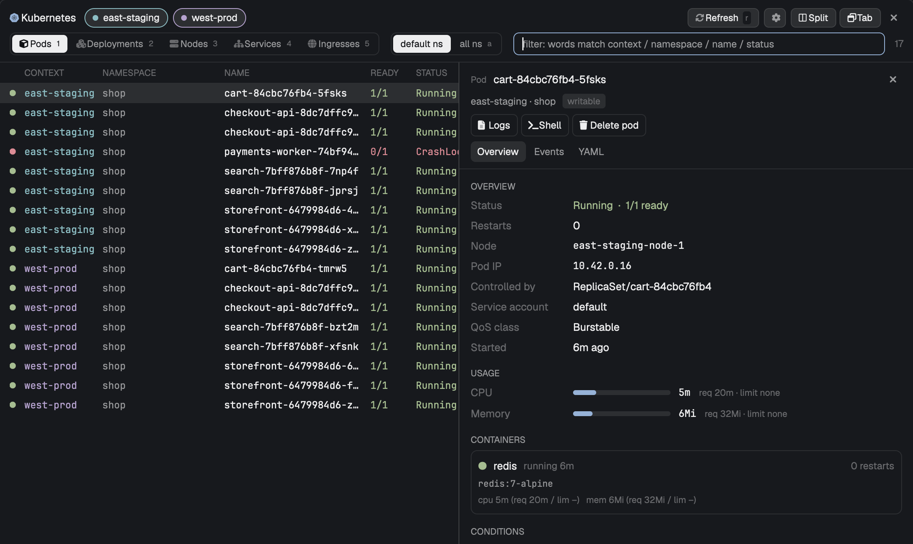

# Kubernetes

A k9s-style Kubernetes browser in a floating Herdr window, opened with `cmd-k`. Pick one or more kube contexts from your kubeconfig and see their pods, deployments, nodes, services and ingresses in one merged list. Click a row for a side panel with overview, usage, events and YAML. Open live, searchable, color-coded logs, and send log lines to a coding agent. Production-looking contexts are read-only until you say otherwise.

## What you see

A floating window (`mod.json`: `place: "none"`, overlay kind `window`, key `kubernetes`, 0.88 of the Herdr window wide, 0.86 high). It uses the Herdr theme tokens throughout (background, surface, raised, border, selected, hover, accent, `ansi1`-`ansi6`), so it follows the active theme. Top to bottom:

1. **Header row.** A Kubernetes glyph in the accent color, the word `Kubernetes` in semibold, then one pill per kube context (24px high, fully rounded, 12px text, 7px dot). A selected pill has a raised background and a border and dot in its own color; an unselected one has a dim label and a border-colored dot. Context colors cycle `ansi6, ansi5, ansi4, ansi3, ansi2, ansi1` in kubeconfig order. On the right: a spinner while any list is loading, a `Refresh` button (24px high, hotkey badge `r`), a gear button, and, only when running as the floating window, `Split`, `Tab` and a close (x) button.
2. **Control row**, with a bottom border. A segmented control for the kind, `Pods` `Deployments` `Nodes` `Services` `Ingresses`, each with an icon and a hotkey badge `1` to `5` (the selected segment is solid, `solid` / `solid_foreground`). A second segmented control, `default ns` and `all ns` (badge `a`). A filter input (28px high, placeholder `filter: words match context / namespace / name / status`, accent border while focused). A dim count of the rows shown.
3. **List** on the left, a draggable-split panel area on the right. Column header 26px, 11px dim text; rows 24px in the editor font at 12px, every second row on the `surface` color, the selected row on `selected` with a semibold name. Columns: a status dot (18px), `CONTEXT` (96px, in the context's color), `NAMESPACE` (150px, hidden for nodes), `NAME` (flexible, at least 180px), kind columns, `AGE` (50px).
   - Pods: `READY` 56, `STATUS` 150, `RESTARTS` 92, `NODE` 220.
   - Deployments: `READY` 64, `UP-TO-DATE` 84, `AVAILABLE` 78, `IMAGE` 300 (image names reduced to their last path segment).
   - Nodes: `STATUS` 170, `ROLES` 110, `VERSION` 150, `IP` 120.
   - Services: `TYPE` 100, `CLUSTER-IP` 120, `PORTS` 200, `EXTERNAL` 260.
   - Ingresses: `CLASS` 90, `HOSTS` 340, `ADDRESS` 260.
   - The dot and the first column take a status color: green (`ansi2`) healthy, amber (`ansi3`) transitional, red (`ansi1`) failing, dim for a deployment scaled to zero, plain for services and ingresses. A pod's restart count turns amber when above 0. Empty states read `Pick a context above`, `Loading…`, `No match` or `Nothing here`.
4. **Side panel**, closed at first, 560px wide when opened, resizable, with a left border. Header: kind label (11px dim), the resource name (semibold, truncated), a spinner while loading, a 22px close button. Under it `<context> · <namespace>` and a badge: `read-only` (red text on `ansi1` at alpha `22`, with a lock icon) or `writable` (dim on `raised`). Then the action buttons (bordered, 12px) and three tabs: `Overview`, `Events` (adds `· N` and a warning icon when some events are warnings), `YAML`.
   - Overview sections, each with an 11px uppercase muted title and 116px label column:
     - Pod: Overview (status, restarts, node, pod IP, controlled by, service account, QoS class, started), Usage (CPU and memory meters), Containers (one card each: state, restart count, image, last exit reason and code, per-container cpu/mem against requests and limits, ports, probes), Conditions.
     - Deployment: Overview (replicas, strategy, revision, rollout, paused, selector, images), Usage (summed over its pods), Pods.
     - Node: Overview (health, scheduling, instance type, zone, pool, roles, internal IP, kubelet, OS, runtime), Usage (against allocatable), Taints, Conditions, Pods.
     - Service: Overview, Ports, Endpoints (matching pods).
     - Ingress: Overview, Rules (`host/path -> service:port`), TLS.
     - Every kind ends with Labels and Annotations as chips and a Created line.
   - Meters are a 120x6px bar that turns amber above 75% and red above 90%, then the value and `req`/`limit` (or `of <allocatable>`) text. Without metrics-server the Usage section says `No metrics`.
   - Pod tables inside Deployment, Node and Service panels have columns dot, NAME, READY, STATUS, RST, CPU, MEM, AGE sized to fit 360px, 26px rows, at most 60 pods.
   - The Events tab lists up to 200 events newest first, with the reason in red (Warning) or green, the object, a `xN` count in amber, the age, and the message. Empty text: `No events (the API server keeps them about an hour)`.
   - The YAML tab is a read-only YAML editor in the terminal font at 12px with theme-colored syntax; `managedFields` and the `last-applied-configuration` annotation are removed.
5. **Footer**, 26px, 11px dim text, top border. Left: list errors in red (`<context>: <message>`), otherwise a transient note in amber, otherwise empty. Right: key hints `/ filter`, `1-5 kind`, `a all ns`, `↵ logs`, `space panel`, `o/v/y tabs`, `s shell`, `R restart`, `S scale`, `X delete pod`, `esc back`.

**Log view** replaces the list inside the same window:

- Title row: a `Back` button (badge `esc`), `pod/<name>` / `deploy/<name>` / `svc/<name>`, `<context> · <namespace>`, a spinner while fetching, and a status that reads `live` (green), `paused` or `previous container` (dim).
- Range row: a segmented control `tail 500`, `5m`, `15m`, `30m`, `1h`, `3h`, `6h` (badges `1` to `7`), then chips `pause`/`follow`, `previous` (pods only), `time`, `wrap`, a level chip (`All levels`, `≥ Warn`, `Errors`), `clear`.
- Search row: search input (placeholder `search logs  (Enter next · ⇧Enter prev)`), `only matches`, a match counter (`3/12`, or the line count), up and down chips, `N picked` with an unpick chip when lines are picked, `Copy all` (or `Copy` for a pick), `Ask agent`.
- When `Ask agent` is open: a surface-colored bar `Ask about N picked lines` / `N shown lines`, an input (placeholder `What should the agent look at? (Enter to send)`), and the chips `New session ↵` and `Current session`.
- When the log has more than one pod: one pill per pod (22px high, in that pod's color, with its line count). Click toggles a pod off. Pod colors, in order: `#4fb3ff #ffaf5f #d787d7 #87d787 #af87ff #ff875f #00d7ff #ffd700 #ff5f87 #87d7af`.
- Log area in the editor font at 12px. Each line: optional time (`HH:MM:SS.mmm`, local, 92px, dim), a pod column (56px, the last dash-separated part of the pod name, in the pod's color) when there is more than one pod or the target is not a single pod, and the text. Text is colored: JSON keys cyan (`ansi6`), strings amber (`ansi3`), URLs blue (`ansi4`), numbers and `true/false/null` magenta (`ansi5`), level words colored by level. Error lines get a 2px red left border and a red tint (`ansi1` at alpha `14`); warning lines a 2px amber left border (`ansi3` at alpha `aa`). Search hits are highlighted amber (alpha `55`), the current hit in the accent color. Picked lines use the `selection` color. A thin custom scrollbar sits at the right; while not at the end a `latest (G)` pill (with a down icon) floats at the bottom right.
- Footer: line count (or the error in red) and hints `/ search`, `n/N match`, `f only`, `e level`, `1-7 since`, `space pause`, `t time`, `w wrap`, `c copy`, `a ask`, `esc back`.

**Describe view**: `kubectl describe` output in a read-only YAML-highlighted editor under a title row (`describe <resource>/<name>`, `<context> · <namespace>`, `Back`).

**Gear popup**: a 380px card under the gear, titled `Changes allowed`, one 34px row per context (color dot, name, `read-only` in red or `writable` in green, a 30x16 toggle). Click a row to flip it.

## How it behaves

**Read-only rule.** A context is read-only if `settings.json` in the data folder has an entry for it (`{"readOnly": {"<context>": true|false}}`), otherwise if its name matches `/prod/i`. The gear popup writes that file, so any context, including a `prod` one, can be made writable (and any other one read-only) with one click; the choice persists. Read-only contexts: `Restart`, `Scale`, `Delete pod`, `Cordon`/`Uncordon` and `Shell` are shown dim with a lock, clicking or pressing their key only shows the note `<context> is read-only`. Logs, describe, YAML, events and the overview always work. The rule is enforced in the window, not in kubectl.

**Lists.**
- Nothing is fetched for a context until kubeconfig has been read. `default ns` uses each context's own namespace from kubeconfig (`default` if it has none); `all ns` lists every namespace and fetches each one. Nodes are always cluster-wide.
- Data comes from the API server's table view (what `kubectl get` prints), so rows are small. The selected kind refreshes every 20 seconds while the window is visible; data younger than 15 seconds is reused; 2.5 seconds after opening, the other four kinds are fetched once in the background so switching is instant. `r` or the `Refresh` button forces a refetch. A failed fetch keeps the old rows and shows the error in the footer.
- Lists and the last view are saved to disk when the window closes and loaded at once on the next open, then refreshed.
- The filter is split on spaces; a row stays if every word appears in `context namespace name <columns>` (case-insensitive). While typing, a dropdown under the input offers up to 6 completions (context names, namespaces and resource names already loaded, prefix matches first); `Tab` takes the first.
- Opening a pod from a Deployment/Node/Service panel row switches to Pods, turns on `all ns` if the pod's namespace is not the default one, and filters by that pod's name.
- The window opens with the filter focused.

**Mouse.** Click a context pill to add/remove it (at least one context is selected automatically if none was). Click a row: select it and open the side panel. Click the same row again: close the panel. Click twice within 400ms: open its logs, leaving the panel as it was (Nodes and Ingresses open describe instead).

**Keys in the list** (when the filter is not focused): `j`/`k` or `↓`/`↑` move; `PageDown`/`PageUp` and `ctrl-d`/`ctrl-u` move 15; `g`/`Home`, `G`/`End` jump; `1`-`5` kind; `l` or `Enter` logs (describe for Nodes and Ingresses; a Deployment or Service with no selector shows `no selector to follow`); `d` describe; `o`, `v`, `y` open the panel on Overview, Events, YAML; `p` or `space` toggle the panel; `s` shell into the pod; `R` rolling restart of a deployment (cordon/uncordon on a node); `S` scale a deployment; `X` delete a pod; `r` refresh; `a` toggle all namespaces; `/` focus the filter; `Esc` closes, in this order: the gear popup, the panel, the filter text, the window. In the filter: `↓`/`↑` still move the row, `Enter` opens the row's logs, `Esc` closes an open panel, otherwise closes the window if the filter is empty, then returns to the list keys.

**Changes.** `Restart`, `Scale`, `Delete pod` and `Cordon` show a confirmation card in the panel with the exact command (`<context>: kubectl <args>`), `Confirm ↵` and `Cancel esc`. Scale has a replicas input prefilled with the current count and accepts a whole number 0 to 50. Delete runs `kubectl delete pod <name> --wait=false`. After a change the footer shows the last line of kubectl's output (a check or cross icon), and the list and panel refresh. `Shell` opens a new tab named `<context>/<pod>` running `kubectl exec -it` with `bash` if the pod has it, else `sh`, then closes the window.

**Panel.** Loads the selected row; rows passed over while a load is in flight are skipped and the row you stop on loads next. While the window is visible the open panel refreshes every 10 seconds; YAML is only rewritten when the resource version changes. A failed refresh keeps what is shown. Metrics (CPU/memory) are optional.

**Logs.**
- A log polls every second while the window is visible (every 10 seconds when it is a hidden tab): the first fetch reads the chosen range, later fetches read only what came after each container's last timestamp, and duplicates are dropped. Pods behind a deployment or service selector are re-listed every 15 seconds. All containers of every matching pod are read.
- `tail 500` reads the last 500 lines per container; the time ranges read up to 3000 lines per container. At most 30000 lines are kept.
- A line's level is guessed from its text (`ERROR`, `FATAL`, `panic`, `Exception`, `"level":"error"`, `fail:`, `WARN`, `DEBUG` and similar); `e` or the chip cycles `All levels`, `≥ Warn`, `Errors`.
- `previous` shows the previous container's log and stops polling. `clear` empties the buffer only.
- Following sticks to the bottom; scrolling up releases it, scrolling back to the end (or `G`) resumes.
- Search is case-insensitive: `n`/`N` or Enter/`⇧Enter` step through hits (the view scrolls to the hit); `only matches` filters lines instead. `Esc`, `Backspace` or `q` clears the search first, then goes back.
- Pick lines by clicking, dragging (the view scrolls at the edges), shift-click for a range, cmd/ctrl-click to add one. Clicking the only picked line unpicks it.
- `c` or `Copy` puts the picked lines (or all shown lines) on the clipboard as `timestamp pod/container message` and posts a toast `Copied N log lines`.
- The range, time, wrap and level choices carry over to every log. The search text and the open log are saved when the window closes; the last 3000 lines are cached, and if the same log is reopened within 10 minutes it shows those lines at once and fetches only what is newer.
- Keys: `/` or `ctrl-f` search, `f` only matches, `space`/`p` pause or follow, `t` time, `w` wrap, `g`/`Home` top, `G`/`End` latest, `1`-`7` range, `r` reload, `c` copy, `a` ask, `Esc`/`Backspace`/`q` back.

**Ask agent.** `a` or the `Ask agent` chip opens the bar; the question is optional (a default asks what is going on and the likely cause). The message contains the question, a header naming the resource, context, namespace and time span, the log lines, and a `kubectl --context <ctx> -n <ns> logs ...` hint. The lines are the picked ones, else everything currently shown (search, level and pod filters applied).
- `New session` (or `Enter` in the input) opens a new tab named `ask: <name>` running `claude` with that message as its task. Its folder is the working folder of the `claude`/`codex` session found in the active tab, else the active space's folder.
- `Current session` sends the message with `hc send <agent address> <message>` to the agent in the active tab, then focuses that pane. With no agent in the tab the note is `No agent in the current tab`.
- Over 60000 characters, only the last 60000 are put in the message and all lines are written to `ask-<timestamp>.log` in the data folder.
- Either way the window closes.

**Pin it elsewhere.** `Split` opens the same view (kind, filter, and open log) as a pane split to the right (`pane.split`); `Tab` opens it as a new tab (`tab.new`); the floating window then closes.

## Built from

- Files in `mods/kubernetes/`: `mod.json`, `main.js` (the `View` class: list, logs, describe, proxy handling, actions), `detail.js` (side-panel data loading, units, YAML, drawing of Overview and Events), `proxy.sh`. `gpui-kit.d.ts` and `jsconfig.json` in that folder are generated; do not write them by hand. Plus `keys.json` at the repo root.
- `mod.json`: `{ "place": "none", "title": "Kubernetes", "overlay": { "kind": "window", "key": "kubernetes", "width": 0.88, "height": 0.86 } }`.
- `keys.json`: `{ "global": { "cmd-k": "mod.open:kubernetes" } }`.
- Imports: `View`, `div` from `gpui-kit`; `v_flex`, `h_flex`, `InputState`, `Input`, `Scrollbar`, `v_virtual_list`, `VirtualListScrollHandle`, `Editor`, `EditorState`, `h_resizable`, `resizable_panel`, `Popup` from `gpui-base`; `exec`, `run`, `theme`, `settings`, `fonts`, `props`, `closeOverlay`, `home`, `spaces`, `panes`, `agents`, `notify` from `herdr`; `fs/promises`.
- Herdr commands run: `tab.new` (props `{ name, mod: "kubernetes", props }`, or `{ name, argv: ["claude"], task, folder }`), `pane.split` (`direction: "right"`, `mod: "kubernetes"`), `terminal.open` (`argv`, `place: "tab"`, `name`), `pane.focus` (`terminal`).
- Programs: `kubectl` (`config get-contexts -o name`, `config view -o json`, `describe`, `exec -it`, `rollout restart`, `scale`, `delete pod`, `cordon`/`uncordon`, `proxy`), `sh`, `nohup`, `curl`, `seq`, `find`, `hc send`, `claude`, `pgrep`, `ps -E`, `lsof`.
- **Read path.** Every list, panel, event and log request is an HTTP call to a per-context `kubectl proxy`. `proxy.sh <context> <port> <heartbeat-file>` runs `kubectl proxy --context <ctx> --address 127.0.0.1 --port <port> --reject-methods='^(POST|PUT|PATCH|DELETE)$' --keepalive=60s`, so write methods are rejected by the proxy. The port is `28400 + (hash(context name) % 500)`, i.e. 28400-28899. The mod reuses a proxy if `GET /version` answers on that port and `port-<port>` in the data folder names this context; a port another context owns sends it to the next one. Otherwise it writes `port-<port>` and starts `nohup sh proxy.sh ...` detached and polls `/version` for up to 6 seconds. The mod touches `hb-<context>` in the data folder at most once a minute; the proxy script checks every 30 seconds and exits when the file is older than 10 minutes. Lists ask for `application/json;as=Table;v=v1;g=meta.k8s.io` with `includeObject=None`. Logs use `/pods/<pod>/log?container=...&timestamps=true` with `tailLines`, `sinceSeconds`, `sinceTime`, `previous`. The panel also reads `metrics.k8s.io/v1beta1` (optional) and events.
- **Write path.** Restart, scale, delete, cordon, describe, shell and the context/kubeconfig reads run plain `kubectl --context <ctx> ...` via `exec` and do not go through the proxy.
- **Hardcoded paths.** The proxy script path is `<home>/.config/herdr-app/mods/kubernetes/proxy.sh` and the data folder is `<home>/.config/herdr-app/data/kubernetes`, both built in `main.js`. The folder therefore must be installed as `mods/kubernetes` (not any other name).
- **State.**
  - `localStorage`: `contextList`, `contexts`, `kind`, `allNs`, `defaultNs`, `filter`, `at`, `panelOpen`, `logPrefs`.
  - Data folder: `state.json` (lists of the selected contexts younger than 30 minutes, plus view/kind/filter/open log), `logs.json` (last 3000 lines of the open log, saved on close), `settings.json` (the read-only map), `hb-<context>` heartbeat files, `ask-<timestamp>.log` (only for very large asks; files older than a day are deleted on open). A module-level `memo` object keeps the kind, view and filter between opens within one Herdr session.
- **Fonts.** Icons are Nerd Font glyphs drawn in `JetBrainsMono Nerd Font` when `fonts()` lists it, otherwise in the terminal font (`settings().font_family`, else `JetBrains Mono`). Text uses the UI font; list rows, logs, YAML and meters' numbers use the terminal font.
- Timers (all cancelled in `close()`): 20s list refresh, 10s panel refresh, 1s log poll, 2.5s prefetch, 150ms focus. Late async results are ignored after close.

## Watch out

- **Folder name.** Install as `<config>/mods/kubernetes/` containing `main.js`, `detail.js`, `proxy.sh`, `mod.json`. The proxy path and data folder are absolute paths built from `home()` with `kubernetes` in them; any other folder name breaks the proxy start. Add the `cmd-k` key to `keys.json` but ask before replacing a `cmd-k` binding already in use.
- **Needs** `kubectl` on the PATH that Herdr's `exec` sees, a kubeconfig with at least one context, and working credentials for it (an exec credential plugin runs inside the proxy). The setup also needs `sh`, `curl`, `seq`, `find`, `nohup` (standard on macOS/Linux; not Windows).
- **Proxy ports.** 500 slots from a hash of the context name. A proxy answering `/version` is reused only if `data/kubernetes/port-<port>` names the same context; otherwise the next slot is tried (up to 10). Without that owner file, two contexts that hash alike would share one proxy and show one cluster's rows under the other's name.
- **Read-only is a UI rule.** It guards restart, scale, delete, cordon and shell in this window only; the name test is `/prod/i` on the context name, so a production cluster not named `prod...` is writable until switched in the gear popup, and the gear can switch a `prod` context to writable.
- **Ask agent.** The new-session path hardcodes the command `claude` (`argv: ["claude"]`), so `claude` must be on the PATH of the new tab. The current-session path uses `hc send` and an agent that Herdr's `agents()` reports for the active tab. Finding the working folder only looks for processes named `claude` or `codex` (`pgrep -x`), reads their environment with `ps -E` for `HC_TERMINAL_ID`, and their cwd with `lsof` (macOS-style `ps -E`; macOS/Linux only); if nothing matches it falls back to the space's folder. Log text, which may hold secrets or personal data, is sent to the agent as is.
- **Nerd Font.** Without `JetBrainsMono Nerd Font` the icons (k8s glyph, lock, play/pause, arrows) show as missing glyphs or boxes in the terminal font; the app still works.
- **Limits.** 60 pods per panel table, 200 events, 30000 log lines, 3000 lines per container for time ranges (500 for `tail`), 6 filter completions, scale 0-50, log lines wrapped by an estimate of 7.25px per character and 20px per line (very long unbroken lines may wrap differently). A deployment's events come from the newest 500 events in its namespace. Node panels list pods through a cluster-wide pod query. Events and metrics may be empty on clusters that keep them short or lack metrics-server.
- **Gaps.** No `exec` for read-only contexts (by design), no log download, no namespace picker (only default or all), no CRDs, secrets, configmaps, jobs or statefulsets, no port-forward. Ingress and node rows have no logs; Enter opens describe. `y` opens the panel's YAML tab; there is no separate full-screen YAML view.
- **Construction traps.** Host objects (editors, inputs, timers) cannot be created while rendering, so `ensureYaml()` and all `spawn`/timer calls live in event handlers and tasks, not in `render`. A closed window's timers must be cancelled or they keep polling. The mouse-down handlers call `stop_propagation()` so presses on controls do not drag the window; the log area is scrolled by hand (not a virtual list) so drags can map the pointer to a line. API timestamps drop trailing zeros, so they are padded to nine fractional digits before comparison.

## Done when

- `herdr-app check mods/kubernetes` passes (run from the folder that holds `mods/` and `keys.json`).
- `cmd-k` opens a window 0.88 wide and 0.86 high with the filter focused, a pill for every context in `kubectl config get-contexts -o name`, and the five kind buttons with hotkeys `1` to `5`.
- Selecting a context fills the list within a few seconds; typing part of a name narrows it; `a` switches between `default ns` and `all ns`; the row count updates.
- Clicking a row opens the 560px side panel with Overview, Events and YAML tabs; clicking the same row closes it.
- After a context was used, `curl http://127.0.0.1:<port>/version` answers for some port in 28400-28899 and a `POST` to that proxy is refused; the proxy is gone about 10 minutes after the window was closed.
- A context whose name contains `prod` shows the `read-only` badge, and `Restart`, `Scale`, `Delete pod` and `Shell` are dim with a lock; the gear popup switches it to writable and the badge changes to `writable`; the choice is still there after reopening (`settings.json` in `data/kubernetes`).
- On a writable context, `R` on a deployment shows a confirmation card with the `kubectl ... rollout restart` command; `Cancel esc` closes it without running anything.
- `Enter` on a pod opens live logs; `n`/`N` search hits highlight; `e` cycles the level filter; `c` copies lines and shows the `Copied N log lines` toast.
- `Ask agent` > `New session` opens a tab running `claude` with the logs in its first message.
