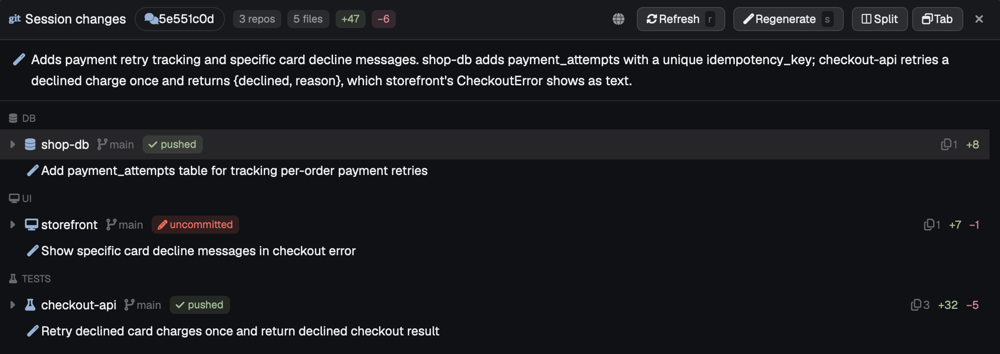

# Session changes

See what a Claude Code session changed across its repos, from a summary down to the diff.

## Privacy

This mod reads your Claude Code transcripts and your repos' diffs, and sends diffs to Claude **automatically, with no prompt**, to write the summaries. A build must do the same, and must say so in its README.

- Transcripts (`~/.claude/projects/...`) are only scanned locally for tool calls; their text is never sent.
- Sent per repo: repo name, commit subjects, the file list (`status path +added -deleted`), and a diff of at most 12000 characters (tracked files: up to 200 files, `-U2`; untracked files: up to 5 files, each cut to 60 lines / 6000 chars). The overview call sends the repos' headlines and points, Jira keys and repo links.
- Command: `claude -p --model haiku --system-prompt <text> --no-session-persistence --disable-slash-commands --strict-mcp-config --setting-sources "" --tools ""`, prompt on stdin from a temporary file, run in a fresh `mktemp -d` folder. `SUMMARY_MODEL = "haiku"` in `summarizer.js`. It uses the user's own Claude login; every call is paid. At most 2 repo summaries run at once.
- Redaction (`redact.js`, applied to diffs, commit subjects, repo and file names, and the overview prompt) replaces matches with `‹v›` (value), `‹t›` (token), `‹u›` (URL user info):
  - values assigned to keys whose last word is a credential word (password, passwd, pass, pwd, secret, token, credential(s), dsn, auth, authorization, api/access/private/account/signing/encryption/secret key, client secret, connection string, auth token), in `=`, `:`, `:=`, `=>` assignments, XML elements, `key`/`name`/`id` + `value` attribute pairs, subscripts and call pairs; `${VAR}`, `$VAR`, `{{x}}`, `<x>`, `%x%` placeholders and type keywords are kept;
  - CLI flags: `--password`, `--secret`, `--token`, `--api-key` and similar, `docker login -p`, `sqlcmd -P`, `curl -u`, `mysql`/`psql`/`mongo`/`redis-cli` `-p<pw>`;
  - `scheme://user:pass@` and `user:pass@host` user info;
  - token shapes: `AKIA...`, `ghp_`, `github_pat_`, `glpat-`, `glsa_`, `sk_/pk_/rk_ live/test`, `AIza...`, `npm_`, `sk-`, `xox[baprs]-`, values after `Bearer`, JWTs (`eyJ...`);
  - `-----BEGIN ... PRIVATE KEY-----` blocks; in diff hunks, 32+ character base64-like runs that mix lower case, upper case and digits and do not read as words; any line over 1000 characters becomes `‹long line›`.
  - Before redaction, diff sections for noise files (lockfiles, `*.Designer.cs`, `*.g.cs`/`*.g.ts`, `*.generated.*`, `*.snap`, `*.min.js`, `*.min.css`, `*.dacpac`, `*.map`) and secret-named files are dropped: `.env*`, `*.pem`, `*.key`, `*.p12`, `*.pfx`, `*.jks`, `*.tfvars`, `*.tfstate`, `id_rsa`/`id_ed25519`/`id_ecdsa`, `*secret(s).json|yaml|yml|txt`, `.npmrc`, `.netrc`, `.pgpass`, `.git-credentials`, `.htpasswd`, `.dockercfg`, `kubeconfig*`, `credential(s)[.json|yaml|yml|txt|ini|xml|csv]`, `appsettings*.json`, `service-account*.json`. Their rows show a `secret` chip and `Secret file: diff hidden`.
- Redaction is best effort, not a guarantee: code and data that do not look like credentials go out as written.
- Stored locally: summaries in the mod's `localStorage` (key `session-changes.summary.<sessionId>.<repoRoot>#<language>`, newest 40 kept); the language in `<appHome>/data/session-changes.json`; prompt files in `<appHome>/session-changes-tmp/` (folder mode 700, each file deleted after its call); for "Diff in VS Code", base versions of files in a `mktemp -d` folder (`umask 077`) removed when the window closes. Nothing is written inside the repos.

## What you see

A floating window (`mod.json`: `place: "none"`, `size: 460`, `focusable: true`, overlay kind `window`, key `session-changes-panel`, 1000 wide, 680 high, at x 200, y 80). Herdr theme tokens throughout (`chrome` background, `surface`, `raised`, `border`, `selected`, `hover`, `accent`, `dim`, `muted`, `blocked`, `ansi1`, `ansi2`, `ansi6`); 12.5px text. Icons are Nerd Font glyphs when `JetBrainsMono Nerd Font` is installed, else drawn in the terminal font. Top to bottom:

1. **Header** (`surface`, bottom border, padding 10 x 8). App glyph, `Session changes` (bold 13px), a session pill (24px, rounded, border; the session name, else the first 8 characters of the session id; tooltip `Pick another Claude session (p)`), then chips (18px, 10.5px semibold): `N repos`, `N files` (muted), `+N` (`ansi2`), `-N` (`ansi1`), `N unpushed` (`ansi6`, only when above 0). Right: a language icon button, `Refresh` (hotkey badge `r`), `Regenerate` (badge `s`, dim and inert until a row is selected), then the window buttons: floating gives `Split`, `Tab` and a close icon; docked gives `Float` (badge `cmd-enter`).
2. **Overview line** (13px, bottom border), only when 2 or more repos have a summary: a sparkle glyph and two or three sentences on what the session did and how the repos connect. Muted while stale or being rewritten (`writing the overview…` with a spinner); shows the error text if writing failed and there is no earlier text.
3. **Tree** (left, full width until a diff opens). Rows, in this order per repo:
   - **Layer header** (28px, 10px uppercase semibold dim, layer icon): `DB`, `SERVICE`, `SDK`, `API`, `UI`, `TESTS`, `OTHER`, in that order. Repos inside a layer are sorted by label.
   - **Repo row** (30px): caret, layer icon (accent), repo name (semibold), branch icon and branch (11px dim), state chip, then right-aligned file icon and count of the session's files, `+N` green, `-N` red, and a spinner while its summary is being written. Chip: `uncommitted` (`blocked` color, pencil icon), `unpushed` (`ansi6`, upload icon), `no upstream` (`ansi6`, upload icon), `pushed` (`ansi2`, check icon). If two repos share a folder name the label is the last two path parts.
   - **Headline row** (22px, sparkle glyph in accent, text truncated): the model headline (at most 80 characters). `summarizing…` with a spinner while running; dim when the summary is stale (the repo changed since); red with a warning glyph when it failed (`Summary failed: ...` or `Summary timed out (30 s limit)`). Without a summary it shows the first commit subject of the session, if any.
   - When the repo is expanded: **point rows** (20px, 11px dim, `· text`, up to 5, at most 160 characters each), a **links row** (22px: `<label> → <repo, repo>` with a tag icon for a shared Jira key, a submodule icon, or a link icon for shared identifiers), then **folder rows** (22px, the folder path relative to the repo's common folder) and **file rows** (24px, indented 34px: status icon `A` green plus, `M` `blocked` pencil, `D` red minus, `U` red warning; file name; `secret` chip in `ansi1`; `+N` and `-N`). Files the session did not edit or commit appear after a divider `other source`, at 0.55 opacity. Footers: `+ N more files`, `+ N more files not shown`, `+ N lockfiles / generated (hidden)`.
   - Selected row on `selected`. Clicking a repo toggles it; clicking a file opens its diff.
4. **Diff pane** (opens to the right of the tree when a file is open; width is 40% of the window, clamped to 340-560px; left border). A 34px header with status icon, the folder in dim and the file name in semibold, an `other source` chip for non-session files, two icon buttons only when `code` is found (`Open in VS Code (o)`, `Diff in VS Code (d)`), and a close icon (`Close the diff (esc)`). Below, monospace 11px rows of 20px: `@@` hunk lines on `raised`, added lines on a green tint (`ansi2` at alpha 18) and removed lines on a red tint (`ansi1` at alpha 18), 36px line-number column, horizontal scroll. At most 1500 lines per diff, lines over 4000 characters cut with `… (line truncated)`. A secret file shows `Secret file: diff hidden`.
5. **Footer** (11px, top border), only when there is something to say: a message from the last action (dock or VS Code error), the store error, the first warning (`<repo>: <error>`, `(+N more)`), or `Reading transcript N%` while a large transcript loads (dim; the others in `ansi1`).
6. **Session picker** and **language picker** replace the tree while open: a list of rows (30px) with, for sessions, the name and working folder; for languages, a globe or check icon and the language name. Empty list: `No Claude sessions running`.

Empty states (in the tree area, dim): `Looking for a Claude session…`, `No Claude session. Focus a terminal running claude, or press p.`, `Reading the session…`, `No changes this session`, or the error text.

## How it behaves

- **Which session.** In order: (1) `props().session` (set when the window is docked, tabbed or re-floated); (2) the file `session-changes.pin` in the app home (`appHome()`), whose trimmed text is a session id (the mod only reads it, never writes it); (3) the focused terminal, if its foreground program's name starts with `claude`: `hc get <address> --json` gives the pid and `~/.claude/sessions/<pid>.json` gives `sessionId`, `cwd`, `name`; (4) the newest (highest `seq`) of the agents Herdr reports for Claude Code. `p` lists those agents' sessions; picking one starts over with it.
- **What it reads.** `~/.claude/projects/*/<sessionId>.jsonl` and `~/.claude/projects/*/<sessionId>/subagents/*.jsonl`, in chunks of 6 MB with at most 28 MB per poll and 4 files at once (`dd` + `awk`; only lines containing `"tool_use"`), remembering the byte offset per file so a poll reads only what is new. A line too big to read is skipped and reported in the footer. If a file shrinks, reading restarts. From each entry it takes the timestamp, `cwd`, and:
  - `Edit`, `Write`, `MultiEdit` (`file_path`) and `NotebookEdit` (`notebook_path`): the file is the session's;
  - `Bash`: the working directory, every `cd <dir>` target, every `git -C <dir>` target (up to 12 directories per command; `;`, `|`, `&` and newlines split the command), and every absolute, `~/` or `$HOME/` path token as a weak hint.
  Relative paths resolve against the entry's `cwd`; `~` and `$HOME` expand to the home folder.
- **Which repos.** Each touched directory (or the nearest existing parent) is resolved to its git root (the nearest ancestor holding `.git`). A repo is shown only when it has at least one session file: a file the session edited, or one changed by a non-merge commit made after the session first touched the repo (up to 60 s after the last touch).
- **The diff base.** The diff of a repo is the working tree against the newest first-parent commit on `HEAD` older than one second before the session first touched the repo (the empty tree when the repo has no commits). It includes staged, unstaged and untracked files (read with `head -c`, all of them in one shell call; symlinks and binary files are not previewed). Rename detection is off.
- **Noise.** Lockfiles (`package-lock.json`, `pnpm-lock.yaml`, `yarn.lock`, `packages.lock.json`, `bun.lock`/`bun.lockb`, `Cargo.lock`, `poetry.lock`), `*.Designer.cs`, `*.g.cs`/`*.g.ts`, `*.generated.*`, `*.snap`, `*.min.js`, `*.min.css`, `*.dacpac`, `*.map` are hidden and counted; `dist/`, `bin/`, `obj/`, `__snapshots__/` are hidden for files the session did not own. At most 1500 files per repo are kept and 300 rows per repo are drawn.
- **Layers** (`graph.js`, heuristics, no config): a repo name containing a whole word `e2e`, `test`, `tests`, `loadtest(s)` is `tests`; `db`, `database`, `migration(s)`, `schema` is `db`. Otherwise the non-test files vote by path: `.sql`/`.sqlproj` db; `.proto` or a `Sdk`/`Client` path part sdk; `Controllers/`, `EndPoints/`, `Endpoints/` or an `Api` path part api; `.vue .svelte .tsx .jsx .scss .css`, and `.ts` under `src/components|pages|views|stores|composables/`, ui; `.cs` service. The majority wins; only test files gives `tests`; an empty vote falls back to the repo name (`sdk`/`client`, `api`/`gateway`/`server`, `web`/`ui`/`frontend`/`app`) else `other`. A test file is under `e2e/`, `test(s)/`, `__tests__/`, a `*Test(s)/` folder, or named `*.spec|test.[jt]s(x)` or `*Feature.cs`.
- **Links between repos** (only when 2 or more repos have session files; the strongest link per pair wins): a shared Jira key (`ABC-123`, from commit subjects and branch names); a `.gitmodules` URL whose last part is the other repo's folder name; shared distinctive identifiers in added lines (camelCase or snake_case, 6+ characters, minus a stop list), when at least 2 are shared or one is 12+ characters long.
- **Chip.** See Watch out for the exact rule. `ahead` is `git rev-list --count @{u}..HEAD`.
- **Refresh.** A 5 s timer polls; an unchanged repo (HEAD, the upstream's commit, the branch name, index and session file sizes/mtimes, plus the session's touch times) is skipped, and a quiet session is re-probed at most every 15 s. After 3 polls in a row in which no transcript grew, the polling slows to every 15 s, after 3 more to every 30 s; growth or `r` goes back to 5 s, and `r` forces a full re-read. The subagent file list is globbed again only after the transcript grew, on `r`, or every 30 s.
- **Summaries.** Written automatically once a repo has settled, 2 at a time, only when the stored one is for a different state. A repo is settled when its probe has not changed for 25 s, or when the session has not touched it for 25 s (a time rule, not a count of polls). A state is the session's commit subjects (not HEAD, so a commit, amend, rebase or pull that leaves the diff and the subjects alone costs no call) plus each session file's status, added/deleted counts and size on disk; file times are not part of it, so a touch or a formatter pass that changes no counts and no content costs no call. A change of under 3 changed lines on the same files does not trigger one. The overview is written when there are 2 or more repos, all summaries are done and nothing is changing. `s` (or `Regenerate`) rewrites the selected repo's summary now. A failed attempt is not retried until the repo changes. Each summary is cached per session, repo and language; a different language starts a new set. Output format: JSON `{headline, points}` (2-5 points), or `{overview}` (at most 300 characters asked, 400 kept).
- **Language.** The picker choice (saved) wins; else Claude Code's `language` setting in `~/.claude/settings.json`, mapped by `languageFromClaude` (`zh*`/`chinese`/`traditional` gives Traditional Chinese, `ja`/`japanese` gives Japanese, `en`/`english` gives English; Simplified Chinese and anything else is ignored); else English. The model is told to keep identifiers, routes, SP and table names, fields, config keys and paths verbatim.
- **Keys** (the window handles them while focused; plain keys only, nothing with cmd, ctrl or alt except `cmd-enter`): `j`/`down` and `k`/`up` move; `Enter`/`space` toggle a repo or open a file's diff; `l`/`right` expand and `h`/`left` collapse a repo; `r` refresh; `p` session picker; `s` regenerate the selected repo; `o` open the file in VS Code; `d` open a VS Code diff (base version against the file; a deleted file is just opened); `cmd-enter` dock or float; `Esc` closes the picker (either), else the diff, else the floating window. `o`/`d` act on the selected file or the open diff.
- **Window.** `Split`: closes any session-changes pane in the focused tab, runs `pane.split` (`direction: "right"`, `mod: "session-changes"`, props `{ session, name }`) beside the focused pane, and closes the window. `Tab`: `tab.new` in the focused space with the mod and props. `Float` (docked): opens the overlay again and closes the focused session-changes pane. `cmd-enter` does Split when floating and Float when docked.
- **Close.** Cancels the timer, stops pending work and deletes the VS Code base-version folder.

## Built from

- Files in `mods/session-changes/`: `mod.json`, `package.json` (`{ "type": "module", "private": true }`), `main.js` (`View` that hosts `Panel`), `panel.js` (state, keys, rendering), `views.js` and `widgets.js` (drawing), `tree.js` (rows), `store.js` (session run, repos), `summaries.js` (summary scheduling, language slots, overview), `changekey.js` (summary key, change shape), `poll.js` (polling pace), `text.js`, `session.js`, `claude.js`, `transcripts.js`, `reader.js`, `chunks.js`, `transcript.js`, `paths.js`, `roots.js`, `git.js`, `gitparse.js`, `gate.js`, `model.js`, `graph.js`, `diff.js`, `diffpath.js`, `redact.js`, `summary.js`, `summarizer.js`, `summarystore.js`, `overview.js`, `scheduler.js`, `languages.js`, `settings.js`, `keymap.js`, `dock.js`, `vscode.js`, `hash.js`, `io.js`, `scratch.js`, and `test/` (`*.test.mjs` files plus `fakeio.mjs`, run with `node --test` in the mod folder). `keys.json` at the repo root: `{ "global": { "cmd-e": "mod.open:session-changes" } }`. A `preview.png` at the repo root. `gpui-kit.d.ts` and `jsconfig.json` are generated by Herdr, not part of this recipe.
- `mod.json`: `{"place":"none","size":460,"title":"Session changes","focusable":true,"overlay":{"kind":"window","key":"session-changes-panel","width":1000,"height":680,"at":{"x":200,"y":80}}}`.
- Imports: `View`, `div` from `gpui-kit`; `v_flex`, `h_flex`, `Scrollbar`, `v_virtual_list`, `VirtualListScrollHandle` from `gpui-base`; `exec`, `home`, `appHome`, `readTextFile`, `writeTextFile`, `props`, `focused`, `panes`, `agents`, `hc`, `run`, `openOverlay`, `closeOverlay`, `theme`, `settings`, `fonts` from `herdr`; `localStorage`.
- Herdr commands: `pane.split`, `pane.close`, `tab.new`, `hc get <address> --json`.
- Programs: `git`, `claude`, `sh`, `dd`, `awk`, `wc`, `tail`, `head`, `stat`, `mktemp`, `mkdir`, `rm`, `test`, `which`, `code`.
- **Read-only git.** Every `git` call is prefixed `--no-optional-locks --literal-pathspecs -c core.fsmonitor=false -c diff.autoRefreshIndex=false` (`READ_ONLY_GIT` in `git.js`). Calls used: `rev-list`, `rev-parse`, `status --porcelain=v1 -z --no-renames --untracked-files=all`, `diff <base> --raw --numstat -z --no-renames` (a failure fails the snapshot and shows as a footer warning), `diff <base> -U<n> --no-ext-diff --no-textconv` run through `sh` and cut by `head -c` (2 MB for the diff view, 200 KB for summaries and identifiers; paths passed as arguments), `rev-parse HEAD @{u} --abbrev-ref HEAD` (HEAD, upstream commit, branch in one call), `log --no-merges --name-only` (read again only when HEAD, the base or the window start changed; the window end is applied afterwards), `show <base>:<path>`. At most 4 external processes run at once.
- Models and limits: `SUMMARY_MODEL = "haiku"`; diff cap 12000 characters; 200 tracked and 5 untracked files in a summary diff.

## Watch out

- **Same-size edits.** A file is told apart by its status, line counts and size on disk, not git's blob id (with `diff.autoRefreshIndex` off a merely touched file reports an all-zero blob, which would flip the key and pay twice). An edit that keeps the size and the line counts (`retries: 3` → `retries: 5`) does not mark the summary stale until the next real change or `s`.
- **The `pushed` chip compares with the last fetch.** `pushState` in `model.js` returns, in order: `uncommitted` if any session file has changes in the working tree; `no upstream` if `@{u}..HEAD` could not be computed (no upstream, no remote, detached `HEAD`), whether or not commits were counted in the session window; otherwise `unpushed` if `ahead > 0`; otherwise `pushed`. It never asks the server, and ignores uncommitted files that the session did not edit. `ahead` counts all commits not on the upstream, not just the session's.
- **Privacy** (see the first section). Summaries start by themselves; there is no setting to turn them off. A clean room build must add that if wanted.
- **Folder name.** Docking and tabbing open the mod by the name `session-changes`; the folder must be `mods/session-changes`.
- **Needs** `git` and `claude` on the `PATH` that Herdr's `exec` sees, and Claude Code logged in. Without `claude`, every summary fails with `Summary failed: ...` (the rest still works). `code` is optional; without it the VS Code buttons are not drawn.
- **Transcript format.** The mod parses Claude Code's undocumented transcript JSONL (`message.content[]` items of type `tool_use`, top-level `timestamp` and `cwd`) and `~/.claude/sessions/<pid>.json`; a Claude Code update can break it. Transcript not found shows `Transcript not found`.
- **Attribution limits.** Only edits by `Edit`, `Write`, `MultiEdit`, `NotebookEdit` and commits during the session count as the session's. Files changed only by shell commands (`sed -i`, generators) and left uncommitted are not attributed, and a repo with no attributed file is not listed. Several sessions working in one repo at the same time cannot be told apart in commits.
- **Platform.** Shell tools: `dd`, `awk`, `wc -c`, `tail -c +N`, `head -c`, `mktemp -d`, `sh`. `stat -f "%N %m:%z"` in the change probe (`probeOf` in `git.js`) is BSD/macOS syntax. On Linux, GNU `stat -f` means filesystem status and does not understand `%N %m:%z`, so the probe is the same for every file; the window then only notices the session's own edits (touch times) and HEAD changes, and hand edits need `r`. Not tested on Linux. Windows is not supported.
- **Limits.** Transcript read 28 MB per poll; 1500 files per repo kept, 300 rows per repo drawn; 1500 diff lines (a tracked diff of over 20000 changed lines is not read: the pane says it is too large and gives the counts; any other tracked diff is read up to 2 MB and says so when it is cut); summary diff 12000 characters; 40 cached summaries; 3 languages; claude call limit 30 s (the error text mentions it).
- **Construction traps.** Host objects (timers, focus handles, scroll handles) must be created in `init` or in `cx.spawn` tasks, not while rendering; release them in `close`. Mouse-down on buttons calls `stop_propagation()` so a press does not drag the window. Results of late async work are dropped when the session changed (`epoch`/`run` checks).
- **Nerd Font.** Without `JetBrainsMono Nerd Font` the icons draw as boxes in the terminal font; the app still works.

## Done when

- `herdr-app check mods/session-changes` passes (from the folder holding `mods/` and `keys.json`).
- `node --test` inside `mods/session-changes` passes (316 tests).
- `cmd-e` opens a 1000 by 680 window; with a Claude Code terminal focused, the session pill shows that session's name and the tree lists the repos it edited under layer headers.
- A repo edited by the session shows its branch, a state chip and `+`/`-` counts; with uncommitted edits the chip reads `uncommitted`; with a clean repo that has no upstream it reads `no upstream`.
- A repo row gets a headline (spinner and `summarizing…` first). With 2 or more repos an overview line appears under the header.
- Enter on a repo expands it to points, folders and files; Enter on a file opens the diff pane (340-560px) with green and red lines and `Esc` closes it; a `.env` file shows a `secret` chip and `Secret file: diff hidden`.
- `p` lists Claude sessions and picking one reloads the tree; writing a session id into `<appHome>/session-changes.pin` and reopening the window selects that session.
- The globe button offers Traditional Chinese, English and Japanese; choosing one rewrites summaries in it and `data/session-changes.json` holds `summaryLanguage`.
- `Split` docks the view beside the focused pane, `Tab` opens it as a tab, `Float` (or `cmd-enter`) goes back; `o` and `d` open VS Code when `code` exists.
- `git status` in a touched repo shows nothing new after using the window (nothing is written to repos), and `<appHome>/session-changes-tmp/` holds no prompt files once calls finish.
