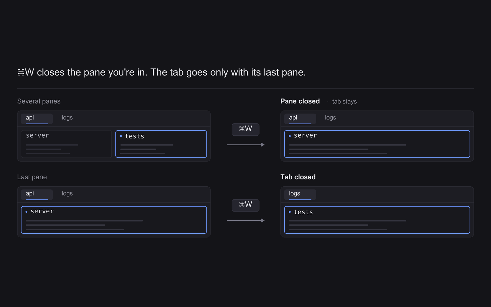

# Smart close

`cmd-w` closes the pane you're in; the tab goes only with its last pane.

## Features

- `cmd-w` closes the focused pane if the current tab is split, so you never lose the whole tab by accident.
- `cmd-w` closes the tab when it has a single pane, so the key never does nothing.
- No UI: the mod opens a 1x1 popup, acts, and closes it in the same step.

## Requirements

- Herdr desktop app on macOS or Linux

## Install

Tell your Herdr agent:

> Read ~/.config/herdr-app/AGENTS.md, then add this mod: https://github.com/iml885203/herdr-mods/tree/main/smart-close

By hand: copy `mods/smart-close` into `~/.config/herdr-app/mods/`, merge this folder's `keys.json` into your own, then run `herdr-app check mods/smart-close`.

## Keys

| Key | Action |
| --- | --- |
| `cmd-w` | Close the focused pane (tab has more than one pane) or the tab (one pane) |

## What it runs / Safety

- It calls only the Herdr commands `pane.close` and `tab.close`. It runs no external programs and reads and writes no files.
- There is no confirmation step. It closes exactly what the built-in commands would close, so a program running in that pane ends the way it does for any pane close.
- It takes over `cmd-w`; remove the key from `keys.json` to get the old behavior back.

## License

MIT
