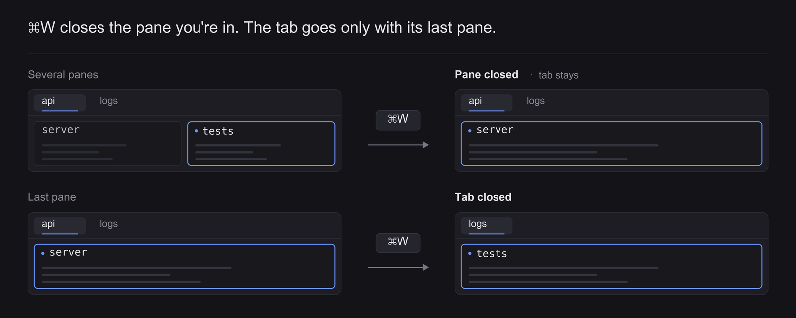

# Smart close

A `cmd-w` key for Herdr that closes the right thing. If the current tab is split into several panes, `cmd-w` closes only the focused pane. If the tab has one pane, `cmd-w` closes the tab. It has no window of its own: nothing is drawn, nothing is clicked.

## What you see

Nothing. The mod is declared as a popup (`mod.json`: `place: "none"`, title `Smart close`, overlay kind `popup`, width `1`, height `1`), and `render()` returns an empty `div()`. The popup is closed inside `init()`, so what you see is the result: a pane or a tab disappearing.

## How it behaves

- `cmd-w` (bound under `global` in `keys.json` to `mod.open:smart-close`) opens the mod. `init()` runs once per key press and does everything:
  1. Finds the active tab: the entry with `active` set inside the active space's `tabs` (from `spaces()`).
  2. If the mod was opened as an overlay (`props().overlay` is set), closes that overlay with `closeOverlay`.
  3. If there is no active tab, stops. Nothing is closed.
  4. If `tab.panes > 1`, runs `pane.close` (the focused pane).
  5. Otherwise runs `tab.close` with `{ id: tab.id }`.
- There is no confirmation, no toast, no animation, and no state kept between presses.
- Panes and tabs closed this way are closed by the app's own commands, so other mods that watch closes (for example one that reopens the last closed tab) see them like any other close.

## Built from

- Files: `mods/smart-close/main.js`, `mods/smart-close/mod.json`, and `keys.json`. `jsconfig.json` and `gpui-kit.d.ts` in the folder are generated by Herdr and are not needed in a fresh build.
- `main.js`: one class `SmartClose extends View` (from `gpui-kit`, with `div`), with `init()` and `render()`. No `props` roles are read except `props().overlay`.
- `herdr` functions used: `spaces()`, `props()`, `closeOverlay()`, `run()`.
- Commands called: `pane.close` (no arguments) and `tab.close` (`{ id }`).
- `keys.json`: `{ "global": { "cmd-w": "mod.open:smart-close" } }`.
- No external programs, no files, no art.

## Watch out

- **Folder name.** The key is `mod.open:smart-close`, so the folder must be `mods/smart-close/`.
- **It replaces `cmd-w`.** If `cmd-w` is already bound in `keys.json`, ask before replacing it.
- **`pane.close` takes no id.** It closes whatever Herdr considers the focused pane at that moment, right after the overlay is closed in the same step. A fresh build should keep the order used here (close the overlay first, then the command).
- **Counting.** The decision uses `tab.panes` of the active tab only, as reported by `spaces()`. It does not look at other tabs or spaces, and it does not distinguish a mod pane from a terminal pane.
- **No guard.** A single-pane tab closes immediately, including when it is the last tab of a space; what Herdr then does with an emptied space is up to the app, not this mod.
- **Gaps.** No confirmation, no undo (that belongs to other mods), no configuration.

## Done when

- `herdr-app check mods/smart-close` passes (run from the folder that holds `mods/` and `keys.json`).
- In a tab split into two panes, `cmd-w` closes the focused pane and the other pane and the tab stay.
- In a tab with one pane, `cmd-w` closes the tab.
- No popup stays on screen after the key press.
